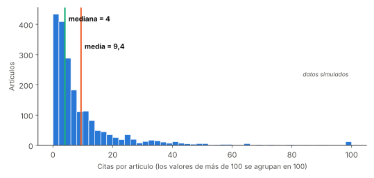

# Capítulo 2. Medir la ciencia {#sec-cap2}

::: {.callout-note appearance="default"}
## Objetivos
- Entender qué representan las citas y cómo se distribuyen.
- Calcular e interpretar indicadores como el índice h y los indicadores normalizados.
- Aplicar los principios del Manifiesto de Leiden para usar las métricas con responsabilidad.
:::

::: {.callout-note appearance="simple" icon="false"}
## Glosario del capítulo
[Cita](92-glosario.qmd#gl-cita) · [Índice h](92-glosario.qmd#gl-indiceh) · [Factor de impacto](92-glosario.qmd#gl-fi) · [Normalización por campo](92-glosario.qmd#gl-normalizacion) · [Distribución asimétrica](92-glosario.qmd#gl-asimetrica) · [Altmetría](92-glosario.qmd#gl-altmetria) · [Manifiesto de Leiden](92-glosario.qmd#gl-leiden)
:::

::: {.callout-tip appearance="simple" icon="false"}
## Descargas
[Script R del capítulo](plantillas/02_medir.R){.btn .btn-outline-primary .btn-sm download="02_medir.R"}
[Plantilla de entrega del reto (.qmd)](plantillas/entrega_reto.qmd){.btn .btn-outline-primary .btn-sm download="entrega_reto.qmd"}
[Tema de estilo (.scss)](plantillas/informe.scss){.btn .btn-outline-primary .btn-sm download="informe.scss"}
:::

## Lectura obligatoria

::: {.lectura}
Hicks, D.; Wouters, P.; Waltman, L.; de Rijcke, S.; Rafols, I. (2015). [Bibliometrics: The Leiden Manifesto for research metrics](https://doi.org/10.1038/520429a). *Nature*, 520(7548), 429-431.
:::

### Lecturas complementarias {.unnumbered}

- Hirsch, J. E. (2005). [An index to quantify an individual's scientific research output](https://doi.org/10.1073/pnas.0507655102). *PNAS*, 102(46), 16569-16572.
- Wang, D.; Song, C.; Barabási, A.-L. (2013). [Quantifying long-term scientific impact](https://doi.org/10.1126/science.1237825). *Science*, 342(6154), 127-132.
- [Declaración de San Francisco sobre la Evaluación de la Investigación (DORA)](https://sfdora.org/read/es/), 2012.

## 1. Qué es una cita

Una **cita** es una referencia de un documento a otro. Merton la veía como el pago de una deuda intelectual; otros autores la ven como un instrumento de persuasión. En la práctica se cita por muchos motivos: reconocer una idea, apoyar un argumento, describir un método, discrepar o, simplemente, porque todo el mundo cita ese trabajo. Por eso las citas miden **uso o visibilidad dentro de la comunidad científica**, no calidad ni verdad.

Tres hechos que conviene tener siempre presentes:

1. **Las citas se distribuyen de forma muy asimétrica.** Unos pocos artículos acumulan muchas citas y la mayoría recibe pocas o ninguna. La **media** está dominada por los extremos; la **mediana** y los percentiles describen mejor lo típico.
2. **Las prácticas de citación varían por campo**: un artículo de biología celular recibe, de media, muchas más citas que uno de matemáticas o de historia. Comparar recuentos brutos entre campos es comparar peras con manzanas.
3. **Las citas tardan en llegar** y su ritmo depende del campo. Los indicadores de ventanas cortas (dos años) favorecen a las disciplinas rápidas.

{#fig-c2-asimetria fig-alt="Histograma de citas por artículo con datos simulados: la mayoría de los 2000 artículos tiene entre 0 y 10 citas y una cola larga llega hasta más de 100. Una línea verde marca la mediana, en torno a 4, y una naranja la media, en torno a 9."}

## 2. Indicadores más usados

| Indicador | Qué mide | Problemas |
|---|---|---|
| **Recuento de citas** | Atención recibida por un trabajo | Depende del campo, la antigüedad y el tipo de documento |
| **Factor de impacto** (de la revista) | Citas medias recibidas por los artículos de una revista en dos años | Es de la **revista**, no del artículo; media de una distribución asimétrica; manipulable |
| **Índice h** (Hirsch, 2005) | El mayor *h* tal que *h* trabajos tienen al menos *h* citas | Crece con la edad académica; ignora las citas de los muy citados; no comparable entre campos |
| **Citas normalizadas** (p. ej. MNCS, FWCI) | Citas relativas a la media mundial del mismo campo, año y tipo | Dependen de cómo se definen los campos |
| **Percentiles** (p. ej. % en el 10 % más citado) | Posición en la distribución del campo | Necesitan muchos trabajos para ser estables |
| **Altmetría** | Menciones en redes, noticias, políticas, gestores | Mide atención, no calidad; fácil de inflar |

El **índice h** es popular porque combina cantidad e impacto en un solo número fácil de calcular, pero precisamente por eso oculta mucho. Dos investigadoras con *h* = 10 pueden tener perfiles muy distintos.

## 3. Laboratorio: calcula un índice h {#lab-c2-h}

::: {.laboratorio}
::: {.laboratorio-etiqueta}
Laboratorio · se ejecuta en tu navegador
:::

Escribe las citas de cada trabajo de un perfil (separadas por comas). El laboratorio las ordena, calcula el índice h y lo compara con la media y la mediana.

```{ojs}
//| echo: false
texto = window.Lab.texto
viewof citas_txt = texto("Citas por trabajo", {value: "120, 45, 30, 22, 15, 12, 9, 8, 6, 5, 3, 2, 1, 0, 0", submit: "Calcular"})
```

```{ojs}
//| echo: false
{
  const c = citas_txt.split(/[,;\s]+/).map(Number).filter(Number.isFinite).sort((a, b) => b - a);
  if (!c.length) return html`<p role="status">Escribe al menos un número.</p>`;
  let h = 0; c.forEach((v, i) => { if (v >= i + 1) h = i + 1; });
  const media = c.reduce((a, b) => a + b, 0) / c.length, med = c.length % 2 ? c[(c.length - 1) / 2] : (c[c.length / 2 - 1] + c[c.length / 2]) / 2;
  const max = Math.max(...c, 1), W = 520, H = 200, bw = Math.max(4, (W - 40) / c.length - 2);
  const barras = c.map((v, i) => `<rect x="${30 + i * (bw + 2)}" y="${H - 20 - (H - 40) * v / max}" width="${bw}" height="${(H - 40) * v / max}" fill="${i < h ? "#2a78d6" : "#a3a29e"}"/>`).join("");
  const fmt = x => x.toLocaleString("es-ES", {maximumFractionDigits: 1});
  const d = html`<div role="status"></div>`;
  d.innerHTML = `<p><strong>Índice h = ${h}</strong> · ${c.length} trabajos · ${fmt(c.reduce((a, b) => a + b, 0))} citas · media ${fmt(media)} · mediana ${fmt(med)}</p>
   <svg viewBox="0 0 ${W} ${H}" width="100%" style="max-width:${W}px" role="img" aria-label="Citas por trabajo ordenadas de mayor a menor; en azul los ${h} trabajos del núcleo h">
   <line x1="28" y1="${H - 20}" x2="${W - 5}" y2="${H - 20}" stroke="currentColor" stroke-opacity=".4"/>${barras}</svg>
   <p class="small">En azul, el «núcleo h». Prueba a cambiar 120 por 1200: el índice h no se mueve, pero la media se dispara.</p>`;
  return d;
}
```
:::

## 4. Calcular con R

```{webr}
#| autorun: true
citas <- c(120, 45, 30, 22, 15, 12, 9, 8, 6, 5, 3, 2, 1, 0, 0)
ordenadas <- sort(citas, decreasing = TRUE)
h <- sum(ordenadas >= seq_along(ordenadas))
h
c(media = mean(citas), mediana = median(citas))
```

La línea clave compara cada recuento con su posición: `seq_along()` genera 1, 2, 3…, y el índice h es cuántas veces las citas igualan o superan la posición.

### Ejercicio 2.1 {.unnumbered}

Calcula el índice h de este perfil.

```{webr}
#| exercise: c2_h
#| setup: true
perfil <- c(4, 25, 0, 9, 7, 1, 15, 3, 8, 2)
```

```{webr}
#| exercise: c2_h
ord <- sort(perfil, decreasing = TRUE)
sum(ord >= ______(ord))
```

::: {.hint exercise="c2_h"}
La función que genera la secuencia 1, 2, 3… de la longitud del vector es `seq_along()`.
:::

::: {.solution exercise="c2_h"}
```r
ord <- sort(perfil, decreasing = TRUE)
sum(ord >= seq_along(ord))
```
h = 5: los cinco trabajos más citados tienen 25, 15, 9, 8 y 7 citas, todos al menos 5; el sexto tiene 4 citas, menos que 6.
:::

```{webr}
#| exercise: c2_h
#| check: true
if (identical(as.integer(.result), 5L)) list(correct = TRUE, message = "Correcto: h = 5.") else
  list(correct = FALSE, message = "Usa seq_along(ord) para comparar cada recuento con su posición.")
```

### Ejercicio 2.2 {.unnumbered}

Un artículo de matemáticas tiene 12 citas; la media mundial de los artículos de matemáticas del mismo año y tipo es 4. Un artículo de biología celular tiene 30 citas y la media de su campo es 40. Calcula la **citación normalizada** (citas / media del campo) del artículo de matemáticas.

```{webr}
#| exercise: c2_norm
12 / ______
```

::: {.hint exercise="c2_norm"}
Divide entre la media de su campo.
:::

::: {.solution exercise="c2_norm"}
```r
12 / 4
```
3: el triple de lo esperado en su campo. El de biología, con 30 citas, obtiene 30 / 40 = 0,75, por debajo de lo esperado. Con recuentos brutos parecería al revés.
:::

```{webr}
#| exercise: c2_norm
#| check: true
if (isTRUE(all.equal(as.numeric(.result), 3))) list(correct = TRUE, message = "Correcto: 3 veces la media de su campo.") else
  list(correct = FALSE, message = "Divide 12 entre 4.")
```

## 5. Usar las métricas con responsabilidad

El **Manifiesto de Leiden** (Hicks et al., 2015) propone diez principios. Los más citados:

1. La evaluación cuantitativa debe **apoyar** el juicio experto cualitativo, no sustituirlo.
2. Medir el desempeño en relación con la **misión** de la institución, el grupo o la persona.
3. Proteger la excelencia en la investigación **local** (incluida la publicada en otros idiomas).
4. Que los procesos de recogida y análisis de datos sean **abiertos, transparentes y sencillos**.
5. Permitir que las personas evaluadas **verifiquen** los datos y los análisis.
6. Tener en cuenta las **diferencias entre campos** en publicación y citación.
7. Basar la evaluación individual en el juicio cualitativo de la **trayectoria**.
8. Evitar la **falsa precisión** (por ejemplo, tres decimales en un factor de impacto).
9. Reconocer los **efectos sistémicos** de la evaluación y de los indicadores.
10. **Revisar y actualizar** los indicadores con regularidad.

La declaración **DORA** (2012) añade una recomendación concreta: no usar métricas de revista, como el factor de impacto, para evaluar artículos ni personas. El acuerdo europeo **CoARA** (2022) compromete a las instituciones firmantes a reformar sus evaluaciones en esa dirección (capítulo 6).

::: {.callout-warning appearance="simple" icon="false"}
## Ley de Goodhart
«Cuando una medida se convierte en objetivo, deja de ser una buena medida». Si se premia el número de artículos, aparecen el troceado de resultados y las revistas depredadoras; si se premian las citas, las autocitas y los círculos de citación.
:::

## Actividades

::: {.clasificar #ia-c2-uso titulo="¿Uso responsable o irresponsable del indicador?" categorias="Responsable|Irresponsable"}
- Ordenar candidatos a una plaza por el factor de impacto medio de sus revistas → Irresponsable // Métrica de revista aplicada a personas (DORA).
- Comparar el impacto de dos grupos de distintas disciplinas con citas normalizadas por campo, como complemento a una evaluación experta → Responsable
- Comparar el índice h de una investigadora de 30 años con el de un catedrático de 65 → Irresponsable // El índice h crece con la edad académica.
- Publicar los datos y el código con que se calcularon los indicadores de una evaluación → Responsable
- Informar de un factor de impacto con tres decimales para distinguir revistas → Irresponsable // Falsa precisión.
- Valorar también la publicación en español en revistas de relevancia local → Responsable
:::

::: {.clasificar #ia-c2-indicador titulo="¿Qué indicador usarías?" categorias="Mediana de citas|Citas normalizadas por campo|Percentil del 10 % más citado|Ninguno: juicio experto"}
- Resumir lo «típico» de un conjunto de artículos con unas pocas superestrellas → Mediana de citas
- Comparar el impacto de dos departamentos de física y de historia → Citas normalizadas por campo
- Saber qué proporción de la producción está entre lo más citado del mundo → Percentil del 10 % más citado
- Decidir si un artículo de este año es valioso → Ninguno: juicio experto // Aún no ha tenido tiempo de recibir citas.
:::

## Reto evaluable {#reto-c2}

::: {.callout-important appearance="simple" icon="false"}
## Reto del capítulo 2 · Auditoría de un indicador
1. Elige un perfil (el tuyo, el de tu grupo o el de una revista de tu campo) y obtén sus datos en una fuente abierta (OpenAlex) y en otra (Google Académico, Scopus o Web of Science).
2. Calcula el recuento de citas, la mediana, el índice h y, si puedes, un indicador normalizado.
3. Compara las fuentes: ¿coinciden? ¿Por qué no?
4. Escribe una valoración del perfil aplicando **cinco** principios del Manifiesto de Leiden.

**Entrega:** un informe reproducible (con el código o la hoja de cálculo) hecho con la [plantilla de entrega](plantillas/entrega_reto.qmd). Este reto **no tiene solución en el libro**.
:::

## Autoevaluación

Responde a todas las preguntas y pulsa **Mostrar respuestas**. No cuenta para la nota.

::: {.webex-check .webex-box}
1. Las citas miden la calidad científica de un artículo. 
2. Si un perfil tiene citas 10, 8, 5, 4 y 3, su índice h es 
3. El factor de impacto es un indicador de la 
4. Para describir lo típico de una distribución de citas muy asimétrica, es mejor la 
5. La declaración que pide no usar el factor de impacto para evaluar personas se llama 
6. Un artículo con 20 citas en un campo cuya media es 10 tiene una citación normalizada de 
7. «Cuando una medida se convierte en objetivo, deja de ser una buena medida» es la ley de 
8. ¿Por qué no se pueden comparar recuentos de citas entre campos?


:::

::: {.webex-solution boton="Ver explicaciones"}
- Miden uso o visibilidad en la comunidad.
- Cuatro trabajos tienen al menos 4 citas; no hay cinco con 5 o más.
- Media de citas de la revista en dos años.
- La media se deja arrastrar por los muy citados.
- DORA, San Francisco, 2012.
- 20 / 10 = 2.
- Charles Goodhart, economista.
- Por eso existen los indicadores normalizados.
:::

## Recursos complementarios

| Recurso | Para qué sirve |
|---|---|
| [Manifiesto de Leiden (web)](http://www.leidenmanifesto.org/) | Los diez principios y sus traducciones |
| [DORA](https://sfdora.org/) | Declaración y recursos para evaluar sin métricas de revista |
| [OpenAlex](https://openalex.org/) | Datos abiertos de citas y autores |
| [CWTS Leiden Ranking](https://www.leidenranking.com/) | Ejemplo de indicadores transparentes y normalizados |
