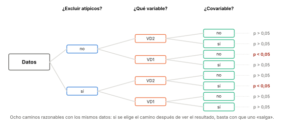

# Capítulo 4. Prácticas cuestionables y sesgos {#sec-cap4}

::: {.callout-note appearance="default"}
## Objetivos
- Reconocer las prácticas de investigación cuestionables y por qué parecen inocentes.
- Comprobar con simulaciones cómo los «grados de libertad del investigador» fabrican falsos positivos.
- Entender el sesgo de publicación y los incentivos que lo sostienen.
:::

::: {.callout-note appearance="simple" icon="false"}
## Glosario del capítulo
[Prácticas cuestionables](92-glosario.qmd#gl-qrp) · [*p-hacking*](92-glosario.qmd#gl-phacking) · [HARKing](92-glosario.qmd#gl-harking) · [Grados de libertad del investigador](92-glosario.qmd#gl-grados) · [Sesgo de publicación](92-glosario.qmd#gl-sesgopub) · [Parada opcional](92-glosario.qmd#gl-parada)
:::

::: {.callout-tip appearance="simple" icon="false"}
## Descargas
[Script R del capítulo](plantillas/04_practicas.R){.btn .btn-outline-primary .btn-sm download="04_practicas.R"}
[Plantilla de entrega del reto (.qmd)](plantillas/entrega_reto.qmd){.btn .btn-outline-primary .btn-sm download="entrega_reto.qmd"}
[Tema de estilo (.scss)](plantillas/informe.scss){.btn .btn-outline-primary .btn-sm download="informe.scss"}
:::

## Lectura obligatoria

::: {.lectura}
Simmons, J. P.; Nelson, L. D.; Simonsohn, U. (2011). [False-positive psychology: Undisclosed flexibility in data collection and analysis allows presenting anything as significant](https://doi.org/10.1177/0956797611417632). *Psychological Science*, 22(11), 1359-1366.
:::

### Lecturas complementarias {.unnumbered}

- John, L. K.; Loewenstein, G.; Prelec, D. (2012). [Measuring the prevalence of questionable research practices with incentives for truth telling](https://doi.org/10.1177/0956797611430953). *Psychological Science*, 23(5), 524-532.
- Fanelli, D. (2010). [«Positive» results increase down the hierarchy of the sciences](https://doi.org/10.1371/journal.pone.0010068). *PLoS ONE*, 5(4), e10068.
- Smaldino, P. E.; McElreath, R. (2016). [The natural selection of bad science](https://doi.org/10.1098/rsos.160384). *Royal Society Open Science*, 3(9), 160384.

## 1. Entre la buena práctica y el fraude

La mala conducta científica en sentido estricto se resume en **FFP**: *fabrication* (inventar datos), *falsification* (manipularlos) y *plagiarism*. Es grave pero relativamente rara. Mucho más frecuentes son las **prácticas de investigación cuestionables** (*questionable research practices*, QRP): decisiones que no son fraude, que a menudo se toman de buena fe y que, sin embargo, aumentan la probabilidad de publicar resultados falsos.

| Práctica | En qué consiste |
|---|---|
| **Informar solo de las variables que salen** | Medir varias variables dependientes y contar solo las significativas |
| **Parada opcional** | Mirar los datos a medida que llegan y dejar de recoger cuando *p* < 0,05 |
| **Excluir datos a conveniencia** | Decidir qué observaciones son «atípicas» después de ver el resultado |
| **Elegir el análisis que funciona** | Probar varias covariables, transformaciones o pruebas y contar solo una |
| **HARKing** (*hypothesizing after the results are known*) | Presentar como hipótesis previa lo que se descubrió al analizar |
| **Redondear *p*** | Escribir *p* = 0,05 cuando es 0,054 |
| **No publicar los resultados nulos** | Guardar en el cajón los estudios que «no salen» |

John et al. (2012) encuestaron a más de 2000 psicólogos con incentivos para responder con sinceridad: muchas de estas prácticas eran admitidas por una proporción considerable, en algunos casos por la mayoría.

## 2. El jardín de los senderos que se bifurcan

Simmons et al. (2011) demostraron con simulaciones que combinar unas pocas decisiones flexibles, cada una defendible por sí sola, puede elevar la tasa de falsos positivos del 5 % nominal a **más del 60 %**. Gelman y Loken llamaron a este problema el «jardín de los senderos que se bifurcan»: aunque solo se haga un análisis, la elección depende de los datos, y otros datos habrían llevado a otro camino.

{#fig-c4-jardin fig-alt="Diagrama en árbol. Desde «Datos» salen dos ramas (excluir atípicos: sí o no), cada una se divide según la variable dependiente (VD1 o VD2) y cada una otra vez según la covariable (sí o no). De los ocho caminos finales, dos dan p menor que 0,05 y seis p mayor que 0,05."}

## 3. Laboratorio: fabrica un falso positivo sin hacer trampa {#lab-c4-phacking}

::: {.laboratorio}
::: {.laboratorio-etiqueta}
Laboratorio · simulación en tu navegador
:::

Simulamos 2000 estudios en los que **no hay ningún efecto real** (dos grupos idénticos). Con un análisis honesto y único, alrededor del 5 % sale significativo por azar. Activa las decisiones flexibles y mira cómo sube la tasa de falsos positivos.

```{ojs}
//| echo: false
casilla = window.Lab.casilla
rango = window.Lab.rango
viewof dos_vd = casilla("Medir dos variables dependientes correlacionadas y quedarse con la que salga", {value: false})
viewof parada = casilla("Parada opcional: si no sale, añadir 10 personas por grupo (hasta dos veces)", {value: false})
viewof atipicos = casilla("Probar también el análisis excluyendo los valores extremos", {value: false})
viewof subgrupo = casilla("Probar también solo en un subgrupo (por ejemplo, solo mujeres)", {value: false})
viewof n_ini = rango("Personas por grupo al inicio", [10, 100], {step: 5, value: 20})
```

```{ojs}
//| echo: false
{
  let s = 7; const u = () => (s = (s * 16807) % 2147483647) / 2147483647;
  const norm = () => Math.sqrt(-2 * Math.log(u())) * Math.cos(2 * Math.PI * u());
  const Phi = z => { const t = 1 / (1 + 0.2316419 * Math.abs(z)), d = 0.3989423 * Math.exp(-z * z / 2);
    const p = d * t * (0.3193815 + t * (-0.3565638 + t * (1.781478 + t * (-1.821256 + t * 1.330274)))); return z > 0 ? 1 - p : p; };
  const pval = (a, b) => { const m = x => x.reduce((p, q) => p + q, 0) / x.length;
    const v = x => { const mm = m(x); return x.reduce((p, q) => p + (q - mm) ** 2, 0) / (x.length - 1); };
    const z = (m(a) - m(b)) / Math.sqrt(v(a) / a.length + v(b) / b.length); return 2 * (1 - Phi(Math.abs(z))); };
  const persona = () => { const y1 = norm(), y2 = 0.5 * y1 + Math.sqrt(0.75) * norm(); return {y1, y2, sexo: u() < 0.5}; };
  const S = 2000; let fp = 0;
  for (let k = 0; k < S; k++) {
    let A = Array.from({length: n_ini}, persona), B = Array.from({length: n_ini}, persona), sig = false;
    for (let ronda = 0; ronda < (parada ? 3 : 1) && !sig; ronda++) {
      if (ronda > 0) { A = A.concat(Array.from({length: 10}, persona)); B = B.concat(Array.from({length: 10}, persona)); }
      const vds = dos_vd ? ["y1", "y2"] : ["y1"];
      for (const vd of vds) {
        const conj = [[A, B]];
        if (subgrupo) conj.push([A.filter(p => p.sexo), B.filter(p => p.sexo)]);
        for (const [a0, b0] of conj) {
          const a = a0.map(p => p[vd]), b = b0.map(p => p[vd]);
          if (a.length > 2 && b.length > 2 && pval(a, b) < 0.05) sig = true;
          if (atipicos) { const f = x => x.filter(v => Math.abs(v) < 2); const af = f(a), bf = f(b); if (af.length > 2 && bf.length > 2 && pval(af, bf) < 0.05) sig = true; }
        }
      }
    }
    if (sig) fp++;
  }
  const t = fp / S;
  const d = html`<div role="status"></div>`;
  d.innerHTML = `<p style="font-size:1.2rem">Tasa de falsos positivos: <strong>${(100 * t).toFixed(1).replace(".", ",")} %</strong> <span class="${t <= .06 ? "lab-bien" : t <= .15 ? "lab-medio" : "lab-mal"}" style="font-weight:600">${t <= .06 ? "· lo nominal" : "· inflada"}</span></p>
   <svg viewBox="0 0 520 40" width="100%" style="max-width:520px" role="img" aria-label="Barra de la tasa de falsos positivos"><rect x="10" y="8" width="500" height="20" rx="4" fill="#d9d8d4"/><rect x="10" y="8" width="${500 * t}" height="20" rx="4" fill="#eb6834"/><line x1="${10 + 500 * .05}" x2="${10 + 500 * .05}" y1="2" y2="34" stroke="currentColor" stroke-width="2"/><text x="${14 + 500 * .05}" y="38" font-size="10" fill="currentColor">5 % nominal</text></svg>
   <p class="small">2000 estudios simulados sin efecto real; prueba aproximada con la distribución normal. Activa las cuatro decisiones a la vez.</p>`;
  return d;
}
```
:::

## 4. Sesgo de publicación

El **sesgo de publicación** aparece cuando la probabilidad de publicar un estudio depende de su resultado. Fanelli (2010) encontró que la proporción de artículos que confirman su hipótesis es altísima en muchas disciplinas y mayor en las ciencias sociales que en las físicas. Si los resultados nulos se quedan en el cajón, la literatura publicada es una muestra sesgada de lo investigado: los metaanálisis heredan el sesgo y sobrestiman los efectos.

Algunas señales de alarma en una literatura:

- Demasiados resultados positivos para la potencia de los estudios.
- Valores *p* que se amontonan justo por debajo de 0,05.
- Estudios pequeños con efectos grandes y estudios grandes con efectos pequeños (asimetría en el **gráfico de embudo** de un metaanálisis).

## 5. Incentivos: la selección natural de la mala ciencia

¿Por qué persisten estas prácticas si casi nadie quiere engañar? Smaldino y McElreath (2016) mostraron con un modelo evolutivo que, si se premia sobre todo el **número de publicaciones positivas**, los laboratorios que usan métodos de menor potencia y más flexibles producen más «éxitos», reciben más recursos y forman a más investigadores que copian esos métodos. Sin cambiar los incentivos, la mala ciencia se selecciona sola, aunque las personas actúen de buena fe. Es el puente hacia los capítulos 5 y 6.

## 6. Calcular con R

### Ejercicio 4.1: dos variables dependientes {.unnumbered}

Simulamos estudios sin efecto real en los que se miden dos variables independientes entre sí y se informa de la que salga. Completa el código para calcular la tasa de falsos positivos.

```{webr}
#| exercise: c4_dosvd
#| setup: true
set.seed(1)
p_vd1 <- replicate(3000, t.test(rnorm(20), rnorm(20))$p.value)
p_vd2 <- replicate(3000, t.test(rnorm(20), rnorm(20))$p.value)
```

```{webr}
#| exercise: c4_dosvd
sale <- p_vd1 < 0.05 | p_vd2 < ______
mean(sale)
```

::: {.hint exercise="c4_dosvd"}
El umbral es el mismo para las dos variables: 0.05.
:::

::: {.solution exercise="c4_dosvd"}
```r
sale <- p_vd1 < 0.05 | p_vd2 < 0.05
mean(sale)
```
Alrededor del 10 %: el doble del 5 % nominal. Con variables independientes, la probabilidad es 1 − 0,95² ≈ 0,0975. Con más variables o más decisiones, sigue subiendo.
:::

```{webr}
#| exercise: c4_dosvd
#| check: true
if (is.numeric(.result) && .result > 0.08 && .result < 0.12) list(correct = TRUE, message = paste0("Correcto: ", format(round(100 * .result, 1), decimal.mark = ","), " % de falsos positivos.")) else
  list(correct = FALSE, message = "Usa 0.05 como umbral para la segunda variable.")
```

## Actividades

::: {.clasificar #ia-c4-tipo titulo="¿Mala conducta, práctica cuestionable o buena práctica?" categorias="Mala conducta (FFP)|Práctica cuestionable|Buena práctica"}
- Inventar los datos de diez participantes que faltaban → Mala conducta (FFP)
- Dejar de recoger datos en cuanto el resultado es significativo → Práctica cuestionable
- Decidir y registrar antes de empezar el criterio de exclusión de atípicos → Buena práctica
- Presentar como hipótesis inicial algo que se descubrió explorando los datos → Práctica cuestionable // HARKing.
- Retocar una imagen de un gel para que la banda se vea mejor → Mala conducta (FFP)
- Informar de todas las variables medidas, también las no significativas → Buena práctica
- Copiar sin citar un párrafo de otro artículo → Mala conducta (FFP)
:::

::: {.escenario #ia-c4-dilema titulo="El análisis que no sale"}
Tu estudio preregistrado no encuentra el efecto esperado (*p* = 0,11). Tu directora sugiere probar otras opciones.

### El resultado {#c4e-inicio}
¿Qué haces?

- [Pruebo varias covariables hasta que sale significativo y lo publico así](#c4e-hack)
- [Mantengo el análisis preregistrado como principal y añado análisis exploratorios etiquetados como tales](#c4e-explora)

### Sendero bifurcado {#c4e-hack .final .mal}
Has convertido un resultado nulo en un probable falso positivo. Además, se desvía del preregistro sin decirlo: quien lea el artículo no podrá valorarlo.

### Transparencia {#c4e-explora}
Un análisis exploratorio con una covariable sale significativo. ¿Cómo lo presentas?

- [En el resumen, como hallazgo principal](#c4e-resumen)
- [Como exploratorio, que habría que confirmar con datos nuevos, y publico también el resultado nulo principal](#c4e-bien)

### Titular engañoso {#c4e-resumen .final .regular}
Aunque lo etiquetes en el texto, destacarlo en el resumen da una impresión equivocada de la evidencia.

### Resultado nulo publicado {#c4e-bien .final .bien}
Publicas un resultado nulo bien hecho, que reduce el sesgo de publicación, y una hipótesis nueva para el siguiente estudio. Los informes registrados (capítulo 5) protegen justo este caso.
:::

## Reto evaluable {#reto-c4}

::: {.callout-important appearance="simple" icon="false"}
## Reto del capítulo 4 · El jardín de tu propio análisis
1. Toma un análisis que hayas hecho (o uno publicado en tu campo) y **lista todas las decisiones** que se tomaron: exclusiones, transformaciones, covariables, pruebas, variables.
2. Para cada una, señala si se tomó **antes o después** de ver los datos.
3. Si tienes los datos, haz un **análisis multiverso** sencillo: repite el análisis con las combinaciones razonables y muestra cuántas dan el mismo resultado.
4. Propón cómo blindarías el próximo estudio frente a esas decisiones.

**Entrega:** informe y código con la [plantilla de entrega](plantillas/entrega_reto.qmd). Este reto **no tiene solución en el libro**.
:::

## Autoevaluación

Responde a todas las preguntas y pulsa **Mostrar respuestas**. No cuenta para la nota.

::: {.webex-check .webex-box}
1. Las prácticas de investigación cuestionables son siempre fraude intencionado. 
2. Presentar como hipótesis previa lo descubierto tras analizar los datos se llama 
3. Según Simmons et al. (2011), combinar varias decisiones flexibles puede elevar la tasa de falsos positivos por encima del 
4. Mirar los datos a medida que llegan y parar cuando *p* < 0,05 se llama parada 
5. Con dos variables independientes y α = 0,05, la probabilidad de al menos un falso positivo es aproximadamente 
6. El sesgo de publicación hace que los metaanálisis tiendan a 
7. Smaldino y McElreath (2016) explican la persistencia de la mala ciencia sobre todo por 
8. ¿Qué tienen en común FFP?


:::

::: {.webex-solution boton="Ver explicaciones"}
- A menudo se toman de buena fe.
- *Hypothesizing After the Results are Known*.
- Más del 60 % en su combinación más extrema.
- *Optional stopping*.
- 1 − 0,95² ≈ 0,0975.
- Solo se ve la parte significativa (y exagerada).
- Selección natural de métodos por incentivos.
- *Fabrication, falsification, plagiarism*.
:::

## Recursos complementarios

| Recurso | Para qué sirve |
|---|---|
| [Retraction Watch](https://retractionwatch.com/) | Seguimiento de retractaciones y casos de mala conducta |
| [Código europeo de conducta para la integridad en la investigación (ALLEA)](https://allea.org/code-of-conduct/) | Marco de referencia en Europa |
| [statcheck](https://michelenuijten.shinyapps.io/statcheck-web/) | Comprueba la coherencia de los resultados estadísticos publicados |
