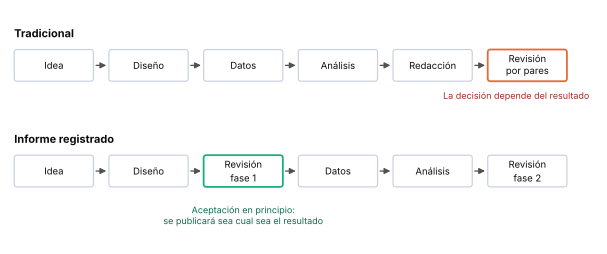

# Capítulo 5. Ciencia abierta y reformas {#sec-cap5}

::: {.callout-note appearance="default"}
## Objetivos
- Conocer las principales reformas propuestas por la metaciencia y las pruebas sobre su eficacia.
- Distinguir preregistro, informe registrado y análisis exploratorio.
- Planificar un estudio con prácticas abiertas proporcionadas a su riesgo y su contexto.
:::

::: {.callout-note appearance="simple" icon="false"}
## Glosario del capítulo
[Ciencia abierta](92-glosario.qmd#gl-cienciaabierta) · [Preregistro](92-glosario.qmd#gl-preregistro) · [Informe registrado](92-glosario.qmd#gl-informe) · [Datos FAIR](92-glosario.qmd#gl-fair) · [Insignias de prácticas abiertas](92-glosario.qmd#gl-insignias) · [Preprint](92-glosario.qmd#gl-preprint)
:::

::: {.callout-tip appearance="simple" icon="false"}
## Descargas
[Plantilla de entrega del reto (.qmd)](plantillas/entrega_reto.qmd){.btn .btn-outline-primary .btn-sm download="entrega_reto.qmd"}
[Tema de estilo (.scss)](plantillas/informe.scss){.btn .btn-outline-primary .btn-sm download="informe.scss"}
:::

## Lectura obligatoria

::: {.lectura}
Munafò, M. R.; Nosek, B. A.; Bishop, D. V. M.; Button, K. S.; Chambers, C. D.; Percie du Sert, N. et al. (2017). [A manifesto for reproducible science](https://doi.org/10.1038/s41562-016-0021). *Nature Human Behaviour*, 1(1), 0021.
:::

### Lecturas complementarias {.unnumbered}

- Nosek, B. A.; Ebersole, C. R.; DeHaven, A. C.; Mellor, D. T. (2018). [The preregistration revolution](https://doi.org/10.1073/pnas.1708274114). *PNAS*, 115(11), 2600-2606.
- Chambers, C. D. (2013). [Registered Reports: A new publishing initiative at *Cortex*](https://doi.org/10.1016/j.cortex.2012.12.016). *Cortex*, 49(3), 609-610.
- Kaplan, R. M.; Irvin, V. L. (2015). [Likelihood of null effects of large NHLBI clinical trials has increased over time](https://doi.org/10.1371/journal.pone.0132382). *PLoS ONE*, 10(8), e0132382.
- Scheel, A. M.; Schijen, M. R. M. J.; Lakens, D. (2021). [An excess of positive results: Comparing the standard psychology literature with Registered Reports](https://doi.org/10.1177/25152459211007467). *Advances in Methods and Practices in Psychological Science*, 4(2).
- Kidwell, M. C. et al. (2016). [Badges to acknowledge open practices: A simple, low-cost, effective method for increasing transparency](https://doi.org/10.1371/journal.pbio.1002456). *PLOS Biology*, 14(5), e1002456.

## 1. Un manifiesto en cinco frentes

Munafò et al. (2017) agrupan las medidas para una ciencia más reproducible en cinco ámbitos:

| Ámbito | Medidas |
|---|---|
| **Métodos** | Proteger frente al sesgo cognitivo (enmascaramiento), mejorar la formación metodológica y estadística, colaborar en equipos grandes |
| **Información** | Preregistrar estudios, seguir guías de comunicación (CONSORT, PRISMA, ARRIVE…) |
| **Reproducibilidad** | Compartir datos, código y materiales; promover la transparencia |
| **Evaluación** | Diversificar la revisión por pares y apoyar la revisión posterior a la publicación |
| **Incentivos** | Premiar la apertura y la calidad, no solo el número de publicaciones positivas |

## 2. Preregistro e informes registrados

Un **preregistro** es un plan del estudio (hipótesis, diseño, muestra, variables, análisis) registrado con fecha antes de ver los datos, en un repositorio público como [OSF Registries](https://osf.io/registries) o [AsPredicted](https://aspredicted.org/). Su función no es prohibir la exploración, sino **distinguir** lo confirmatorio de lo exploratorio (Nosek et al., 2018). Desviarse del plan es legítimo si se declara y se justifica.

Un **informe registrado** (*Registered Report*) va un paso más allá: la revista revisa la introducción, los métodos y el plan de análisis **antes** de recoger los datos y, si los acepta, se compromete a publicar el artículo **sea cual sea el resultado** (Chambers, 2013). Así desaparecen a la vez el incentivo para el *p-hacking* y el sesgo de publicación. Hoy los ofrecen cientos de revistas.

{#fig-c5-informe fig-alt="Dos flujos. Tradicional: idea, diseño, recogida de datos, análisis, redacción y revisión por pares; la decisión depende del resultado. Informe registrado: idea, diseño, revisión de la fase 1 y aceptación en principio, recogida de datos, análisis y revisión de la fase 2, que solo comprueba que se siguió el plan; el resultado no influye en la publicación."}

## 3. Compartir datos, código y materiales

Compartir permite **reproducir**, **reutilizar** y **detectar errores**. Los principios **FAIR** piden que los datos sean localizables, accesibles, interoperables y reutilizables, lo que no siempre significa abiertos: «tan abiertos como sea posible, tan cerrados como sea necesario», por ejemplo con datos personales. Buenas prácticas mínimas:

- Depositar en un repositorio con **DOI** (Zenodo, OSF, un repositorio institucional o temático), no en una web personal.
- Incluir un **README** con la descripción de variables, la procedencia y la licencia.
- Compartir el **código** que va de los datos brutos a las figuras, con las versiones del software.
- Citar los datos y el software como cualquier otra fuente.

## 4. ¿Funcionan las reformas?

La metaciencia también se evalúa a sí misma. Algunas pruebas:

- Tras introducir **insignias** por compartir datos en *Psychological Science*, la proporción de artículos con datos abiertos aumentó mucho más que en revistas comparables (Kidwell et al., 2016).
- En los grandes ensayos clínicos financiados por el NHLBI estadounidense sobre fármacos o suplementos para enfermedades cardiovasculares, la proporción de ensayos con resultado positivo cayó notablemente tras exigirse el **registro previo** del resultado principal en 2000 (Kaplan e Irvin, 2015).
- Los **informes registrados** publican una proporción mucho mayor de resultados que no apoyan la hipótesis que los artículos tradicionales (Scheel et al., 2021).

Son pruebas observacionales en su mayoría, y la investigación sobre qué intervenciones funcionan, en qué disciplinas y con qué costes, sigue abierta. La reforma también tiene riesgos: burocracia, «lavado de ciencia abierta» (*open washing*) o desigualdades entre quienes tienen recursos para cumplir y quienes no.

## 5. Laboratorio: ¿qué prácticas abiertas necesita tu estudio? {#lab-c5-plan}

::: {.escenario #ia-c5-plan titulo="Planifica tu estudio"}
Vas a empezar un estudio empírico de tu tesis.

### Tipo de estudio {#c5p-inicio}
¿Qué tipo de estudio es?

- [Confirmatorio: pongo a prueba una hipótesis concreta](#c5p-confirmatorio)
- [Exploratorio: busco patrones sin hipótesis previa](#c5p-exploratorio)
- [Análisis de datos secundarios que ya existen](#c5p-secundario)

### Confirmatorio {#c5p-confirmatorio}
Tienes una hipótesis y un diseño. ¿Hay una revista de tu campo que acepte informes registrados?

- [Sí](#c5p-rr)
- [No o no lo sé](#c5p-prereg)

### Informe registrado {#c5p-rr .final .bien}
Envía la fase 1 (introducción, métodos, plan de análisis y cálculo de potencia) antes de recoger datos. Comparte datos y código al publicar.

### Preregistro {#c5p-prereg .final .bien}
Preregistra hipótesis, muestra (con su justificación), variables y análisis en OSF o AsPredicted. Declara en el artículo cualquier desviación.

### Exploratorio {#c5p-exploratorio .final .bien}
No hace falta un preregistro confirmatorio, pero sí transparencia: preséntalo como exploratorio, comparte los datos y el código, y considera reservar una parte de los datos para confirmar lo encontrado.

### Datos secundarios {#c5p-secundario}
¿Has explorado ya los datos?

- [No todavía](#c5p-sec-no)
- [Sí, ya los conozco](#c5p-sec-si)

### Preregistro de datos secundarios {#c5p-sec-no .final .bien}
Existen plantillas de preregistro para datos secundarios: registra el plan antes de analizar y declara qué sabías de los datos.

### Ya los conoces {#c5p-sec-si .final .regular}
Un preregistro tendría menos valor, pero aún puedes declarar qué análisis decidiste antes y cuáles después, compartir el código y hacer análisis de robustez o multiverso.
:::

## Actividades

::: {.clasificar #ia-c5-medida titulo="¿A qué problema responde cada reforma?" categorias="Sesgo de publicación|Flexibilidad analítica|Errores no detectados|Incentivos"}
- Informes registrados → Sesgo de publicación // También frenan la flexibilidad analítica.
- Preregistro del plan de análisis → Flexibilidad analítica
- Compartir datos y código → Errores no detectados
- Valorar en las convocatorias los conjuntos de datos y el software publicados → Incentivos
- Revisión posterior a la publicación en plataformas abiertas → Errores no detectados
:::

::: {.ordenar #ia-c5-rr titulo="Ordena las fases de un informe registrado"}
1. Diseñar el estudio y el plan de análisis
2. Enviar la fase 1 a la revista
3. Recibir la aceptación en principio
4. Recoger y analizar los datos
5. Enviar la fase 2 con los resultados
6. Publicar, sea cual sea el resultado
:::

## Reto evaluable {#reto-c5}

::: {.callout-important appearance="simple" icon="false"}
## Reto del capítulo 5 · Tu preregistro
1. Escribe el **preregistro** completo del próximo estudio de tu tesis con la plantilla de OSF o de AsPredicted (hipótesis, diseño, justificación de la muestra, variables, análisis, criterios de exclusión).
2. Incluye un **plan de gestión de datos** de una página: dónde depositarás datos y código, con qué licencia y qué no podrás compartir y por qué.
3. Señala **dos riesgos** de tu plan (por ejemplo, un análisis que dependa de los datos) y cómo los gestionarás.

**Entrega:** el preregistro (sin necesidad de publicarlo) con la [plantilla de entrega](plantillas/entrega_reto.qmd). Este reto **no tiene solución en el libro**.
:::

## Autoevaluación

Responde a todas las preguntas y pulsa **Mostrar respuestas**. No cuenta para la nota.

::: {.webex-check .webex-box}
1. Preregistrar un estudio prohíbe hacer análisis exploratorios. 
2. En un informe registrado, la revista acepta el artículo en principio 
3. Los datos FAIR siempre tienen que ser abiertos. 
4. La guía de comunicación para revisiones sistemáticas es 
5. Según Kidwell et al. (2016), las insignias por compartir datos 
6. Un plan de estudio registrado con fecha antes de ver los datos es un 
7. Desviarse del preregistro es legítimo si se declara y se justifica. 
8. ¿Qué dos problemas elimina a la vez un informe registrado?


:::

::: {.webex-solution boton="Ver explicaciones"}
- Solo pide distinguir lo exploratorio de lo confirmatorio.
- Aceptación en principio tras la fase 1.
- «Tan abiertos como sea posible, tan cerrados como sea necesario».
- PRISMA (CONSORT, ensayos; ARRIVE, animales).
- Aumento muy superior al de revistas comparables.
- *Preregistration*.
- La transparencia es lo esencial.
- La publicación no depende del resultado.
:::

## Recursos complementarios

| Recurso | Para qué sirve |
|---|---|
| [OSF Registries](https://osf.io/registries) | Preregistrar estudios |
| [Registered Reports (COS)](https://www.cos.io/initiatives/registered-reports) | Revistas que aceptan informes registrados |
| [EQUATOR Network](https://www.equator-network.org/) | Guías de comunicación por tipo de estudio |
| [Zenodo](https://zenodo.org/) | Depositar datos y software con DOI |
