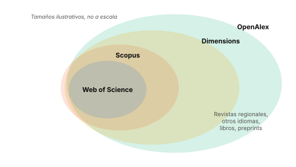

# Capítulo 7. Fuentes de datos e infraestructuras {#sec-cap7}

::: {.callout-note appearance="default"}
## Objetivos
- Conocer las principales fuentes de datos para investigar la investigación: bases bibliográficas, identificadores persistentes, registros y repositorios.
- Comparar su cobertura, sus licencias y sus sesgos, y elegir la adecuada para cada pregunta.
- Leer y explorar datos reales de OpenAlex con R.
:::

::: {.callout-note appearance="simple" icon="false"}
## Glosario del capítulo
[Base de datos bibliográfica](92-glosario.qmd#gl-basebib) · [Cobertura](92-glosario.qmd#gl-cobertura) · [Identificador persistente](92-glosario.qmd#gl-pid) · [Desambiguación de autores](92-glosario.qmd#gl-desambiguacion) · [Metadatos abiertos](92-glosario.qmd#gl-metabiertos)
:::

::: {.callout-tip appearance="simple" icon="false"}
## Descargas
[Plantilla de entrega del reto (.qmd)](plantillas/entrega_reto.qmd){.btn .btn-outline-primary .btn-sm download="entrega_reto.qmd"}
[Datos de OpenAlex del capítulo (.json)](datos/metaciencia_openalex.json){.btn .btn-outline-primary .btn-sm download="metaciencia_openalex.json"}
:::

## Lectura obligatoria

::: {.lectura}
Visser, M.; van Eck, N. J.; Waltman, L. (2021). [Large-scale comparison of bibliographic data sources: Scopus, Web of Science, Dimensions, Crossref, and Microsoft Academic](https://doi.org/10.1162/qss_a_00112). *Quantitative Science Studies*, 2(1), 20-41.
:::

## 1. Un mapa de las fuentes

La investigación sobre la investigación se apoya en datos que producen otros: editoriales, agencias de registro de DOI, bases de datos, financiadores, repositorios. Ninguna fuente es neutral ni completa; conocer qué recoge cada una es el primer paso metodológico.

| Tipo | Ejemplos | Para qué | Acceso |
|---|---|---|---|
| **Bases bibliográficas multidisciplinares** | Web of Science, Scopus, Dimensions, OpenAlex | Producción, citas, colaboración, temas | Comerciales (las tres primeras); abierta CC0 (OpenAlex) |
| **Registros de metadatos de DOI** | Crossref, DataCite | Metadatos de artículos, datos y software; referencias abiertas | Abiertos |
| **Identificadores persistentes** | ORCID (personas), ROR (instituciones), DOI (objetos), Crossref Funder Registry | Desambiguar y enlazar | Abiertos |
| **Bases temáticas** | PubMed/MEDLINE, Europe PMC, arXiv, RePEc, ERIC | Campos concretos, texto completo en algunos casos | Abiertas en su mayoría |
| **Integridad y correcciones** | Retraction Watch (integrada en Crossref desde 2023), PubPeer | Retractaciones, comentarios posteriores | Abiertos |
| **Ciencia abierta** | OSF, registros de ensayos (ClinicalTrials.gov, EU CTR), Zenodo | Preregistros, datos, materiales | Abiertos |
| **Atención en línea** | Altmetric, Overton (documentos de políticas) | Menciones en medios, redes y políticas | Comerciales |
| **Financiación y personal** | Bases de proyectos (CORDIS, AEI), encuestas de carrera | Insumos y resultados | Variable |

{#fig-c7-cobertura fig-alt="Diagrama de conjuntos solapados que representan Web of Science, Scopus, Dimensions y OpenAlex. Web of Science es el más pequeño y está casi contenido en Scopus; Dimensions y OpenAlex son mayores e incluyen más publicaciones no indexadas en las demás, como revistas regionales, libros y documentos en otros idiomas."}

## 2. Cobertura y sesgos

Visser, van Eck y Waltman (2021) compararon a gran escala cinco fuentes. Sus conclusiones principales: las fuentes con criterios de selección (Web of Science, Scopus) son más pequeñas y selectivas; las de indexación amplia (Dimensions, Crossref, la extinta Microsoft Academic, hoy sustituida en gran medida por OpenAlex) cubren muchos más documentos, pero con metadatos de calidad más variable, por ejemplo en afiliaciones o tipos de documento. Las diferencias de cobertura afectan a los resultados: un ranking o un indicador puede cambiar según la fuente.

Sesgos que conviene comprobar siempre:

- **Idioma y región**: las fuentes selectivas infrarrepresentan la investigación publicada en lenguas distintas del inglés y en revistas regionales.
- **Disciplina**: las humanidades y parte de las ciencias sociales publican en libros y en revistas nacionales poco indexadas.
- **Tipo de documento**: artículos, revisiones, editoriales y cartas se clasifican de forma distinta en cada fuente.
- **Tiempo**: la cobertura retrospectiva es desigual y los metadatos se actualizan continuamente.
- **Desambiguación**: asignar trabajos a personas e instituciones es un problema algorítmico con errores; ORCID y ROR lo reducen, no lo eliminan.

## 3. Buenas prácticas con las fuentes

1. Justifica la elección de la fuente según la pregunta (cobertura temática, años, tipo de documento).
2. **Documenta la consulta exacta** y la fecha de descarga; guarda los datos brutos.
3. Usa **identificadores persistentes** para unir fuentes (DOI, ORCID, ROR) en lugar de títulos o nombres.
4. Valida una muestra a mano (por ejemplo, 100 registros) para estimar errores de clasificación.
5. Si es posible, **repite el análisis con una segunda fuente** como prueba de robustez.
6. Prefiere fuentes con **metadatos abiertos**: permiten que otros reproduzcan el estudio (principios de la *Barcelona Declaration on Open Research Information*, 2024).

## Ejemplo resuelto: explorar una muestra de OpenAlex

El archivo del capítulo contiene los 80 artículos más citados que citan al gran proyecto de replicación en psicología de la @opensciencecollabora2015. Así se explora:

```{webr}
#| autorun: true
d <- jsonlite::fromJSON("datos/metaciencia_openalex.json")$trabajos
nrow(d)
table(d$campo)                      # campo científico principal (clasificación de OpenAlex)
summary(d$citas)                    # distribución de citas: muy asimétrica
n_autores <- sapply(d$autores, nrow)
c(media = mean(n_autores), mediana = median(n_autores))
```

## Ejercicios

### Ejercicio 7.1 {.unnumbered}

¿En qué **año** se publicaron más artículos de la muestra?

```{webr}
#| exercise: c7_anio
#| setup: true
d <- jsonlite::fromJSON("datos/metaciencia_openalex.json")$trabajos
```

```{webr}
#| exercise: c7_anio
tab <- table(d$anio)
names(tab)[which.______(tab)]
```

::: {.hint exercise="c7_anio"}
`which.max()` devuelve la posición del valor máximo.
:::

::: {.solution exercise="c7_anio"}
```r
tab <- table(d$anio)
names(tab)[which.max(tab)]
```
:::

```{webr}
#| exercise: c7_anio
#| check: true
x <- jsonlite::fromJSON("datos/metaciencia_openalex.json")$trabajos
esp <- names(table(x$anio))[which.max(table(x$anio))]
if (identical(as.character(.result), esp)) list(correct = TRUE, message = paste("Correcto:", esp)) else list(correct = FALSE, message = "Usa which.max(tab).")
```

### Ejercicio 7.2 {.unnumbered}

¿Qué proporción de artículos tiene **al menos un autor de un país distinto de Estados Unidos** (código `US`)? Redondea a dos decimales.

```{webr}
#| exercise: c7_pais
#| setup: true
d <- jsonlite::fromJSON("datos/metaciencia_openalex.json", simplifyVector = FALSE)$trabajos
```

```{webr}
#| exercise: c7_pais
otro_pais <- sapply(d, function(w) {
  paises <- unlist(lapply(w$autores, function(a) a$paises))
  any(paises != "______")
})
round(mean(otro_pais), 2)
```

::: {.hint exercise="c7_pais"}
El código ISO de Estados Unidos es `US`.
:::

::: {.solution exercise="c7_pais"}
```r
otro_pais <- sapply(d, function(w) {
  paises <- unlist(lapply(w$autores, function(a) a$paises))
  any(paises != "US")
})
round(mean(otro_pais), 2)
```
Ojo: los autores sin país registrado no cuentan, lo que ilustra cómo los metadatos incompletos afectan a los indicadores de internacionalización.
:::

```{webr}
#| exercise: c7_pais
#| check: true
x <- jsonlite::fromJSON("datos/metaciencia_openalex.json", simplifyVector = FALSE)$trabajos
esp <- round(mean(sapply(x, function(w) any(unlist(lapply(w$autores, function(a) a$paises)) != "US"))), 2)
if (isTRUE(all.equal(as.numeric(.result), esp))) list(correct = TRUE, message = paste0("Correcto: ", sub(".", ",", esp, fixed = TRUE))) else list(correct = FALSE, message = "Compara los países con \"US\".")
```

## Actividades

::: {.clasificar #ia-c7-fuente titulo="¿Qué fuente usarías?" categorias="OpenAlex o Crossref|ORCID o ROR|Retraction Watch|Registros de ensayos u OSF"}
- Analizar con datos abiertos y reproducibles las citas de 50 000 artículos → OpenAlex o Crossref
- Desambiguar a qué institución pertenece cada autor → ORCID o ROR
- Estudiar cuántos artículos retractados siguen citándose → Retraction Watch
- Comparar los resultados publicados con los planificados en preregistros → Registros de ensayos u OSF
:::

::: {.clasificar #ia-c7-sesgo titulo="¿Qué sesgo de cobertura afecta?" categorias="Idioma y región|Disciplina|Tipo de documento|Desambiguación"}
- Un estudio sobre producción en humanidades que solo cuenta artículos de revista → Disciplina
- Un ranking de países basado en una fuente que indexa pocas revistas en español → Idioma y región
- Dos «J. García» distintos fusionados en un único perfil → Desambiguación
- Editoriales contadas como artículos de investigación → Tipo de documento
:::

## Reto evaluable {#reto-c7}

::: {.callout-important appearance="simple" icon="false"}
## Reto del capítulo 7 · Dos fuentes, una pregunta
1. Formula una pregunta sencilla sobre tu campo (por ejemplo, evolución de la producción en un tema desde 2015).
2. Respóndela con dos fuentes (por ejemplo, OpenAlex y la base a la que tenga acceso tu universidad). Documenta las consultas y la fecha.
3. Compara los resultados, explica las diferencias por cobertura, clasificación o desambiguación, y valida a mano una muestra de 50 registros.

**Entrega:** con la [plantilla de entrega](plantillas/entrega_reto.qmd). Este reto **no tiene solución en el libro**.
:::

## Autoevaluación

Responde a todas las preguntas y pulsa **Mostrar respuestas**. No cuenta para la nota.

::: {.webex-check .webex-box}
1. Según @visser2021, las fuentes selectivas como Web of Science cubren más documentos que Dimensions. 
2. El identificador persistente para instituciones de investigación es 
3. Los datos de OpenAlex se publican con licencia 
4. Un indicador puede cambiar según la fuente de datos utilizada. 
5. Asignar correctamente los trabajos a cada persona es el problema de la 
6. La base de datos de retractaciones integrada en Crossref es 
7. Conviene documentar la consulta exacta y la fecha de descarga. 
8. ¿Por qué conviene repetir un análisis con una segunda fuente?


:::

::: {.webex-solution boton="Ver explicaciones"}
- Al revés: las de indexación amplia cubren más.
- *Research Organization Registry*.
- Dominio público.
- Por eso se justifica la fuente.
- *Author name disambiguation*.
- Desde 2023.
- Reproducibilidad.
- Prueba de robustez.
:::
