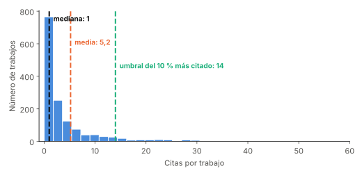

# Capítulo 8. Bibliometría e indicadores {#sec-cap8}

::: {.callout-note appearance="default"}
## Objetivos
- Calcular e interpretar indicadores de producción y de impacto con recuento completo y fraccionario.
- Normalizar las citas por campo, año y tipo de documento, y usar indicadores de percentiles.
- Aplicar los principios del Manifiesto de Leiden al uso responsable de los indicadores.
:::

::: {.callout-note appearance="simple" icon="false"}
## Glosario del capítulo
[Recuento completo](92-glosario.qmd#gl-completo) · [Recuento fraccionario](92-glosario.qmd#gl-fraccionario) · [MNCS](92-glosario.qmd#gl-mncs) · [Indicador de percentil](92-glosario.qmd#gl-percentil) · [Ventana de citación](92-glosario.qmd#gl-ventana) · [Manifiesto de Leiden](92-glosario.qmd#gl-leiden)
:::

::: {.callout-tip appearance="simple" icon="false"}
## Descargas
[Plantilla de entrega del reto (.qmd)](plantillas/entrega_reto.qmd){.btn .btn-outline-primary .btn-sm download="entrega_reto.qmd"}
[Datos de OpenAlex del capítulo (.json)](datos/metaciencia_openalex.json){.btn .btn-outline-primary .btn-sm download="metaciencia_openalex.json"}
:::

## Lectura obligatoria

::: {.lectura}
Waltman, L. (2016). [A review of the literature on citation impact indicators](https://doi.org/10.1016/j.joi.2016.02.007). *Journal of Informetrics*, 10(2), 365-391.
:::

### Lectura complementaria {.unnumbered}

- Hicks, D.; Wouters, P.; Waltman, L.; de Rijcke, S.; Rafols, I. (2015). [Bibliometrics: The Leiden Manifesto for research metrics](https://doi.org/10.1038/520429a). *Nature*, 520(7548), 429-431.

## 1. Contar publicaciones: completo o fraccionario

Cuando un artículo tiene autores de varias instituciones, ¿a quién se atribuye? Hay dos opciones principales:

- **Recuento completo**: cada institución (o país, o persona) suma 1. La suma de todos los créditos supera el número de artículos.
- **Recuento fraccionario**: el artículo se reparte; con 4 autores, cada uno recibe 1/4. La suma total coincide con el número de artículos.

| Artículo | Autores (institución) | Completo: A / B | Fraccionario: A / B |
|---|---|---|---|
| 1 | A, A, B | 1 / 1 | 0,67 / 0,33 |
| 2 | A | 1 / 0 | 1 / 0 |
| 3 | B, B, B, A | 1 / 1 | 0,25 / 0,75 |
| **Total** | | **3 / 2** | **1,92 / 1,08** |

El recuento completo premia la colaboración amplia; el fraccionario es más adecuado para comparar productividad entre unidades con prácticas de colaboración distintas (Waltman, 2016).

## 2. Medir el impacto de citación

Las citas dependen del **campo** (en biomedicina se cita mucho más que en matemáticas), del **año** (los trabajos antiguos han tenido más tiempo) y del **tipo de documento** (las revisiones se citan más). Por eso los indicadores de impacto comparables se **normalizan**:

- **Citación normalizada de un trabajo**: sus citas divididas entre la media de citas de los trabajos del mismo campo, año y tipo. Un valor de 1 equivale a la media mundial.
- **MNCS** (*mean normalized citation score*): la media de las citaciones normalizadas de un conjunto de trabajos.
- **Indicadores de percentiles**: la proporción de trabajos de una unidad que están en el 10 % (o el 1 %) más citado de su campo y año, **PP(top 10 %)**. Son más robustos que las medias, porque una sola publicación muy citada no los dispara.
- **Ventana de citación**: contar las citas en un periodo fijo (por ejemplo, tres años tras la publicación) para comparar cohortes.

Waltman (2016) repasa además los problemas de los indicadores populares: el **factor de impacto** describe revistas, no artículos, y el **índice h** mezcla producción e impacto, depende de la edad académica y del campo, y no se puede normalizar bien.

{#fig-c8-asim fig-alt="Histograma de citas muy sesgado a la derecha, con la mayoría de trabajos con pocas citas y una cola larga. Líneas verticales marcan la mediana, la media y el umbral del 10 % más citado."}

## 3. Uso responsable: el Manifiesto de Leiden

Hicks et al. (2015) propusieron diez principios para evaluar con indicadores. Entre ellos: la evaluación cuantitativa debe **apoyar** el juicio experto, no sustituirlo; hay que medir el desempeño en relación con la **misión** de la unidad; proteger la investigación **relevante localmente**; mantener los datos y el análisis **abiertos y transparentes**; permitir que los evaluados **verifiquen** los datos; tener en cuenta las **diferencias entre campos**; evaluar a las personas con un juicio cualitativo de su trayectoria; evitar la **falsa precisión**; reconocer los **efectos sistémicos** de los indicadores (incentivos y adaptación); y **revisar** los indicadores periódicamente.

## Ejemplo resuelto: recuento fraccionario por país

```{webr}
#| autorun: true
d <- jsonlite::fromJSON("datos/metaciencia_openalex.json", simplifyVector = FALSE)$trabajos
credito <- list()
for (w in d) {
  autores <- Filter(function(a) length(a$paises) > 0, w$autores)
  for (a in autores) for (p in a$paises)          # cada autor reparte su parte entre sus países
    credito[[p]] <- c(credito[[p]], 1 / length(autores) / length(a$paises))
}
frac <- sort(sapply(credito, sum), decreasing = TRUE)
completo <- sort(table(unlist(lapply(d, function(w) unique(unlist(lapply(w$autores, `[[`, "paises")))))), decreasing = TRUE)
head(round(frac, 1), 6)
head(completo, 6)
```

Fíjate en que la suma del recuento fraccionario es, como máximo, el número de artículos con país conocido, mientras que el completo cuenta el mismo artículo varias veces.

## Laboratorio: medias, medianas y percentiles {#lab-c8-percentil}

::: {.laboratorio}
::: {.laboratorio-etiqueta}
Laboratorio · se ejecuta en tu navegador
:::

Dos grupos publican 20 artículos cada uno. El grupo B tiene un único artículo excepcionalmente citado. Mueve sus citas y observa qué indicador cambia.

```{ojs}
//| echo: false
rango = window.Lab.rango
viewof estrella = rango("Citas del artículo más citado del grupo B", [20, 2000], {step: 10, value: 600})
```

```{ojs}
//| echo: false
{
  const A = [3, 5, 8, 9, 10, 12, 12, 14, 15, 16, 18, 20, 22, 25, 28, 30, 35, 40, 45, 60];
  const B = [0, 0, 1, 1, 2, 2, 3, 3, 4, 4, 5, 5, 6, 6, 7, 8, 9, 10, 12, estrella];
  const umbral = 38; // umbral del 10 % más citado del campo (ejemplo)
  const media = v => v.reduce((a, b) => a + b, 0) / v.length, med = v => { const s = [...v].sort((a, b) => a - b); return (s[9] + s[10]) / 2; };
  const top = v => 100 * v.filter(x => x >= umbral).length / v.length;
  const f = x => x.toFixed(1).replace(".", ",");
  const d = html`<div role="status"></div>`;
  d.innerHTML = `<table class="table table-sm"><thead><tr><th scope="col">Indicador</th><th scope="col">Grupo A</th><th scope="col">Grupo B</th></tr></thead><tbody>
   <tr><th scope="row">Media de citas</th><td>${f(media(A))}</td><td><strong>${f(media(B))}</strong></td></tr>
   <tr><th scope="row">Mediana</th><td>${f(med(A))}</td><td>${f(med(B))}</td></tr>
   <tr><th scope="row">PP(top 10 %) · umbral ${umbral} citas</th><td>${f(top(A))} %</td><td>${f(top(B))} %</td></tr></tbody></table>
   <p class="${media(B) > media(A) ? "lab-medio" : "lab-bien"}" style="font-weight:600">${media(B) > media(A) ? "Con la media, el grupo B «supera» al A por un solo artículo, aunque su trabajo típico se cita mucho menos." : "Con estas cifras, la media aún refleja que A tiene más impacto típico."}</p>`;
  return d;
}
```
:::

## Ejercicios

### Ejercicio 8.1 · Recuento fraccionario {.unnumbered}

Un artículo tiene 5 autores: 3 de la institución A y 2 de la B. ¿Qué crédito fraccionario recibe **A**?

```{webr}
#| exercise: c8_frac
autores <- c("A", "A", "A", "B", "B")
sum(autores == "A") / ______(autores)
```

::: {.hint exercise="c8_frac"}
Divide entre el número total de autores: `length(autores)`.
:::

::: {.solution exercise="c8_frac"}
```r
autores <- c("A", "A", "A", "B", "B")
sum(autores == "A") / length(autores)
```
0,6. Con recuento completo, A y B recibirían 1 cada una.
:::

```{webr}
#| exercise: c8_frac
#| check: true
if (isTRUE(all.equal(as.numeric(.result), 0.6))) list(correct = TRUE, message = "Correcto: 0,6.") else list(correct = FALSE, message = "Divide entre length(autores).")
```

### Ejercicio 8.2 · MNCS {.unnumbered}

Calcula el **MNCS** de tres artículos con sus citas y la media de su campo, año y tipo.

```{webr}
#| exercise: c8_mncs
citas <- c(12, 30, 5)
media_campo <- c(4, 40, 10)
mean(citas / ______)
```

::: {.hint exercise="c8_mncs"}
Divide cada recuento entre la media de su campo: `media_campo`.
:::

::: {.solution exercise="c8_mncs"}
```r
citas <- c(12, 30, 5)
media_campo <- c(4, 40, 10)
mean(citas / media_campo)
```
(3 + 0,75 + 0,5) / 3 ≈ 1,42: un 42 % por encima de la media mundial. Sin normalizar, el artículo de 30 citas parecería el mejor, pero es el de 12 citas el que destaca en su campo.
:::

```{webr}
#| exercise: c8_mncs
#| check: true
if (isTRUE(all.equal(as.numeric(.result), mean(c(12, 30, 5) / c(4, 40, 10))))) list(correct = TRUE, message = "Correcto: MNCS ≈ 1,42.") else list(correct = FALSE, message = "Divide entre media_campo y haz la media.")
```

### Ejercicio 8.3 · Percentiles con datos reales {.unnumbered}

¿Cuántas citas hacen falta para estar en el **10 % más citado** de la muestra?

```{webr}
#| exercise: c8_p90
#| setup: true
d <- jsonlite::fromJSON("datos/metaciencia_openalex.json")$trabajos
```

```{webr}
#| exercise: c8_p90
unname(quantile(d$citas, ______))
```

::: {.hint exercise="c8_p90"}
El umbral del 10 % superior es el percentil 90: `0.9`.
:::

::: {.solution exercise="c8_p90"}
```r
unname(quantile(d$citas, 0.9))
```
En un estudio real, el umbral se calcula sobre **todos** los trabajos del mismo campo, año y tipo, no sobre la muestra analizada.
:::

```{webr}
#| exercise: c8_p90
#| check: true
x <- jsonlite::fromJSON("datos/metaciencia_openalex.json")$trabajos
if (isTRUE(all.equal(as.numeric(.result), unname(quantile(x$citas, 0.9))))) list(correct = TRUE, message = "Correcto: es el percentil 90.") else list(correct = FALSE, message = "Usa quantile(d$citas, 0.9).")
```

## Actividades

::: {.clasificar #ia-c8-leiden titulo="¿Respeta el Manifiesto de Leiden?" categorias="Lo respeta|Lo incumple"}
- Contratar a la persona con el índice h más alto sin leer su trabajo → Lo incumple
- Usar PP(top 10 %) normalizado por campo junto con la valoración de un panel → Lo respeta
- Comparar el factor de impacto medio de un grupo de historia y otro de oncología → Lo incumple // Ignora las diferencias entre campos.
- Permitir que los grupos evaluados revisen sus datos antes del informe → Lo respeta
- Dar indicadores con tres decimales para distinguir a los candidatos → Lo incumple // Falsa precisión.
:::

::: {.clasificar #ia-c8-ind titulo="¿Qué indicador es más adecuado?" categorias="Recuento fraccionario|MNCS o percentiles|Ninguno: juicio experto"}
- Comparar la productividad de dos universidades con prácticas de coautoría muy distintas → Recuento fraccionario
- Comparar el impacto de departamentos de física y de sociología → MNCS o percentiles
- Valorar la originalidad de una tesis doctoral → Ninguno: juicio experto
:::

## Reto evaluable {#reto-c8}

::: {.callout-important appearance="simple" icon="false"}
## Reto del capítulo 8 · Un informe bibliométrico responsable
1. Elige una unidad (un grupo, un departamento o una revista) y descarga su producción de cinco años desde OpenAlex.
2. Calcula producción con recuento completo y fraccionario, citas normalizadas y PP(top 10 %) con los umbrales de los campos correspondientes.
3. Redacta un informe de dos páginas que siga los diez principios del Manifiesto de Leiden, incluida la explicación de las limitaciones dentro de la metodología.

**Entrega:** con la [plantilla de entrega](plantillas/entrega_reto.qmd). Este reto **no tiene solución en el libro**.
:::

## Autoevaluación

Responde a todas las preguntas y pulsa **Mostrar respuestas**. No cuenta para la nota.

::: {.webex-check .webex-box}
1. Con recuento fraccionario, la suma de créditos coincide con el número de artículos. 
2. Un MNCS de 1 equivale a 
3. La proporción de trabajos en el 10 % más citado de su campo y año se abrevia PP(top )
4. El factor de impacto es un indicador adecuado para evaluar artículos individuales. 
5. Los indicadores de percentiles son más robustos que las medias frente a valores extremos. 
6. Según el Manifiesto de Leiden, los indicadores deben 
7. Contar citas en un periodo fijo tras la publicación es usar una ventana de 
8. ¿Por qué hay que normalizar las citas por campo?


:::

::: {.webex-solution boton="Ver explicaciones"}
- El completo cuenta varias veces el mismo artículo.
- *Mean normalized citation score*.
- *Proportion of top 10 % publications*.
- Describe revistas, no artículos.
- Un artículo excepcional no los dispara.
- Primer principio.
- *Citation window*.
- Biomedicina frente a matemáticas.
:::
