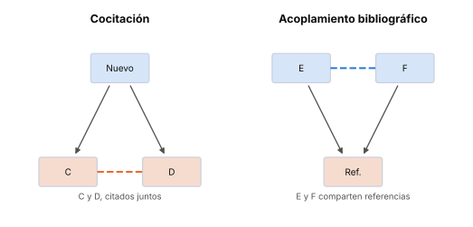

# Capítulo 9. Redes y mapas de la ciencia {#sec-cap9}

::: {.callout-note appearance="default"}
## Objetivos
- Distinguir las redes de citación directa, cocitación, acoplamiento bibliográfico, coautoría y coocurrencia de términos.
- Calcular medidas básicas de redes (grado, densidad, centralidad) y entender la detección de comunidades.
- Construir e interpretar mapas de la ciencia con responsabilidad.
:::

::: {.callout-note appearance="simple" icon="false"}
## Glosario del capítulo
[Cocitación](92-glosario.qmd#gl-cocitacion) · [Acoplamiento bibliográfico](92-glosario.qmd#gl-acoplamiento) · [Red de coautoría](92-glosario.qmd#gl-coautoria) · [Centralidad](92-glosario.qmd#gl-centralidad) · [Detección de comunidades](92-glosario.qmd#gl-comunidades) · [Mapa de la ciencia](92-glosario.qmd#gl-mapa)
:::

::: {.callout-tip appearance="simple" icon="false"}
## Descargas
[Plantilla de entrega del reto (.qmd)](plantillas/entrega_reto.qmd){.btn .btn-outline-primary .btn-sm download="entrega_reto.qmd"}
[Datos de OpenAlex del capítulo (.json)](datos/metaciencia_openalex.json){.btn .btn-outline-primary .btn-sm download="metaciencia_openalex.json"}
:::

## Lectura obligatoria

::: {.lectura}
Boyack, K. W.; Klavans, R. (2010). [Co-citation analysis, bibliographic coupling, and direct citation: Which citation approach represents the research front most accurately?](https://doi.org/10.1002/asi.21419) *Journal of the American Society for Information Science and Technology*, 61(12), 2389-2404.
:::

### Lectura complementaria {.unnumbered}

- van Eck, N. J.; Waltman, L. (2010). [Software survey: VOSviewer, a computer program for bibliometric mapping](https://doi.org/10.1007/s11192-009-0146-3). *Scientometrics*, 84(2), 523-538.

## 1. Cinco formas de relacionar documentos y personas

| Red | Nodos | Hay vínculo cuando… | Sirve para |
|---|---|---|---|
| **Citación directa** | Documentos | A cita a B | Seguir la genealogía de una idea |
| **Cocitación** (Small, 1973) | Documentos citados | C y D aparecen juntos en la bibliografía de un tercero | Ver la estructura intelectual de un campo (sus «clásicos») |
| **Acoplamiento bibliográfico** (Kessler, 1963) | Documentos citantes | E y F comparten referencias | Detectar frentes de investigación recientes |
| **Coautoría** | Personas, instituciones, países | Firman juntos | Estudiar la colaboración |
| **Coocurrencia de términos** | Palabras o temas | Aparecen en el mismo documento | Mapear temas |

{#fig-c9-rel fig-alt="Dos esquemas. A la izquierda, cocitación: un artículo nuevo arriba cita a dos artículos antiguos abajo, que quedan unidos por una línea discontinua. A la derecha, acoplamiento: dos artículos nuevos arriba citan a la misma referencia antigua abajo, y quedan unidos por una línea discontinua."}

Boyack y Klavans (2010) compararon los tres enfoques basados en citas con más de dos millones de artículos biomédicos. Encontraron que el **acoplamiento bibliográfico** delimitaba los frentes de investigación con algo más de precisión que la cocitación, y que la citación directa era la menos precisa en ventanas cortas; los enfoques híbridos que combinan citas y texto mejoraban los resultados.

## 2. Medidas básicas

- **Grado**: número de vínculos de un nodo. En coautoría, con cuántas personas ha firmado alguien.
- **Peso**: intensidad del vínculo (número de referencias compartidas, de artículos conjuntos).
- **Densidad**: proporción de vínculos existentes sobre los posibles.
- **Centralidad de intermediación**: cuántos caminos más cortos pasan por un nodo; identifica «puentes» entre grupos.
- **Detección de comunidades**: algoritmos (Louvain, Leiden) que agrupan nodos más conectados entre sí que con el resto; en mapas de la ciencia, cada comunidad suele interpretarse como un tema.
- **Normalización de similitud**: coseno de Salton o fuerza de asociación, para que los documentos con bibliografías largas no dominen.

## 3. Mapas de la ciencia

Herramientas como **VOSviewer** (van Eck y Waltman, 2010), CiteSpace, bibliometrix (R) o Gephi convierten las redes en mapas. Al leerlos, recuerda que:

- La **posición** refleja similitud, pero la distancia exacta depende del algoritmo y de sus parámetros.
- Los **umbrales** (mínimo de citas o de coocurrencias) cambian qué aparece; documenta y prueba varios.
- Los nombres de los grupos son **interpretaciones** del analista; valídalos con expertos o con lectura de muestras.
- Un mapa es una vista de una fuente y un periodo: no es «el» campo.

## Ejemplo resuelto: acoplamiento con datos reales

```{webr}
#| autorun: true
d <- jsonlite::fromJSON("datos/metaciencia_openalex.json", simplifyVector = FALSE)$trabajos
refs <- lapply(d, function(w) unlist(w$referencias))
n <- length(refs)
acopl <- matrix(0, n, n)
for (i in 1:(n - 1)) for (j in (i + 1):n)
  acopl[i, j] <- acopl[j, i] <- length(intersect(refs[[i]], refs[[j]]))
par_max <- which(acopl == max(acopl), arr.ind = TRUE)[1, ]
cat("Mayor acoplamiento:", max(acopl), "referencias compartidas\n")
cat(" -", d[[par_max[1]]]$titulo, "\n -", d[[par_max[2]]]$titulo, "\n")
c(densidad = round(mean(acopl[upper.tri(acopl)] > 0), 2))
```

## Ejercicios

### Ejercicio 9.1 · Coautoría {.unnumbered}

En la red de coautoría de la muestra, ¿cuántos **coautores distintos** tiene el autor más conectado (su grado)?

```{webr}
#| exercise: c9_grado
#| setup: true
d <- jsonlite::fromJSON("datos/metaciencia_openalex.json", simplifyVector = FALSE)$trabajos
```

```{webr}
#| exercise: c9_grado
coautores <- list()
for (w in d) {
  ids <- unique(sapply(w$autores, `[[`, "id"))
  for (a in ids) coautores[[a]] <- union(coautores[[a]], setdiff(ids, a))
}
grado <- sapply(coautores, length)
______(grado)
```

::: {.hint exercise="c9_grado"}
El grado máximo se obtiene con `max()`.
:::

::: {.solution exercise="c9_grado"}
```r
coautores <- list()
for (w in d) {
  ids <- unique(sapply(w$autores, `[[`, "id"))
  for (a in ids) coautores[[a]] <- union(coautores[[a]], setdiff(ids, a))
}
grado <- sapply(coautores, length)
max(grado)
```
Los artículos con muchísimos autores (los grandes proyectos de replicación) disparan el grado: por eso a menudo se analizan aparte o se fracciona su peso.
:::

```{webr}
#| exercise: c9_grado
#| check: true
x <- jsonlite::fromJSON("datos/metaciencia_openalex.json", simplifyVector = FALSE)$trabajos
co <- list(); for (w in x) { ids <- unique(sapply(w$autores, `[[`, "id")); for (a in ids) co[[a]] <- union(co[[a]], setdiff(ids, a)) }
esp <- max(sapply(co, length))
if (isTRUE(all.equal(as.numeric(.result), esp))) list(correct = TRUE, message = paste("Correcto: grado máximo =", esp)) else list(correct = FALSE, message = "Usa max(grado).")
```

### Ejercicio 9.2 · Similitud del coseno {.unnumbered}

Dos artículos comparten 6 referencias; uno tiene 20 y otro 45. Calcula la **similitud del coseno de Salton**: compartidas / √(n₁ · n₂).

```{webr}
#| exercise: c9_coseno
compartidas <- 6; n1 <- 20; n2 <- 45
round(compartidas / ______(n1 * n2), 3)
```

::: {.hint exercise="c9_coseno"}
La raíz cuadrada en R es `sqrt()`.
:::

::: {.solution exercise="c9_coseno"}
```r
compartidas <- 6; n1 <- 20; n2 <- 45
round(compartidas / sqrt(n1 * n2), 3)
```
0,2. La normalización evita que dos artículos con bibliografías enormes parezcan muy similares solo por citar mucho.
:::

```{webr}
#| exercise: c9_coseno
#| check: true
if (isTRUE(all.equal(as.numeric(.result), 0.2))) list(correct = TRUE, message = "Correcto: 0,2.") else list(correct = FALSE, message = "Divide entre sqrt(n1 * n2).")
```

## Actividades

::: {.clasificar #ia-c9-red titulo="¿Qué tipo de red necesitas?" categorias="Cocitación|Acoplamiento bibliográfico|Coautoría|Coocurrencia de términos"}
- Identificar los trabajos fundacionales de la metaciencia → Cocitación
- Agrupar artículos publicados este año según sus frentes de investigación → Acoplamiento bibliográfico
- Estudiar si la colaboración internacional ha aumentado → Coautoría
- Ver qué temas aparecen juntos en los resúmenes → Coocurrencia de términos
:::

::: {.clasificar #ia-c9-medida titulo="¿Qué medida de red?" categorias="Grado|Intermediación|Densidad|Comunidades"}
- La investigadora que conecta dos grupos que no colaboran entre sí → Intermediación
- Con cuántos coautores distintos ha firmado alguien → Grado
- Qué proporción de posibles colaboraciones se han producido → Densidad
- Agrupar los artículos en temas → Comunidades
:::

## Reto evaluable {#reto-c9}

::: {.callout-important appearance="simple" icon="false"}
## Reto del capítulo 9 · Un mapa de tu campo
1. Descarga 500-2000 artículos de un tema de tu campo desde OpenAlex.
2. Construye en VOSviewer (o con bibliometrix o igraph) un mapa de acoplamiento bibliográfico y otro de coocurrencia de términos.
3. Prueba dos umbrales distintos y explica cómo cambian los grupos.
4. Interpreta las comunidades leyendo al menos cinco artículos de cada una y discute las limitaciones del mapa en la sección de metodología.

**Entrega:** con la [plantilla de entrega](plantillas/entrega_reto.qmd). Este reto **no tiene solución en el libro**.
:::

## Autoevaluación

Responde a todas las preguntas y pulsa **Mostrar respuestas**. No cuenta para la nota.

::: {.webex-check .webex-box}
1. Dos documentos están acoplados bibliográficamente cuando 
2. Dos documentos citados juntos en la bibliografía de un tercero están 
3. Según Boyack y Klavans (2010), la citación directa fue el enfoque más preciso para delimitar frentes de investigación. 
4. El número de vínculos de un nodo es su 
5. Los nombres de los grupos de un mapa son interpretaciones del analista. 
6. VOSviewer es una herramienta para 
7. Cambiar el umbral mínimo de coocurrencias puede cambiar los grupos del mapa. 
8. ¿Para qué sirve la centralidad de intermediación?


:::

::: {.webex-solution boton="Ver explicaciones"}
- Kessler (1963).
- Small (1973).
- Fue la menos precisa en ventanas cortas.
- *Degree*.
- Valídalos con lecturas o expertos.
- van Eck y Waltman (2010).
- Documenta los parámetros.
- *Betweenness centrality*.
:::
