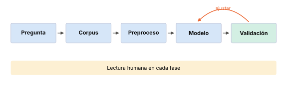

# Capítulo 10. Minería de textos, modelos de temas y modelos de lenguaje {#sec-cap10}

::: {.callout-note appearance="default"}
## Objetivos
- Preparar textos científicos para su análisis (tokenización, palabras vacías, ponderación tf-idf).
- Conocer los modelos de temas y los enfoques basados en *embeddings* y modelos de lenguaje.
- Validar cualquier clasificación automática frente a una codificación de referencia.
:::

::: {.callout-note appearance="simple" icon="false"}
## Glosario del capítulo
[Tokenización](92-glosario.qmd#gl-token) · [tf-idf](92-glosario.qmd#gl-tfidf) · [Modelo de temas](92-glosario.qmd#gl-temas) · [Embedding](92-glosario.qmd#gl-embedding) · [Validación](92-glosario.qmd#gl-validacion) · [Precisión y exhaustividad](92-glosario.qmd#gl-precision)
:::

::: {.callout-tip appearance="simple" icon="false"}
## Descargas
[Plantilla de entrega del reto (.qmd)](plantillas/entrega_reto.qmd){.btn .btn-outline-primary .btn-sm download="entrega_reto.qmd"}
[Datos de OpenAlex del capítulo (.json)](datos/metaciencia_openalex.json){.btn .btn-outline-primary .btn-sm download="metaciencia_openalex.json"}
:::

## Lectura obligatoria

::: {.lectura}
Grimmer, J.; Stewart, B. M. (2013). [Text as data: The promise and pitfalls of automatic content analysis methods for political texts](https://doi.org/10.1093/pan/mps028). *Political Analysis*, 21(3), 267-297.
:::

## 1. El texto como dato

Títulos, resúmenes, textos completos, informes de revisión, convocatorias o políticas científicas son fuentes masivas para la metaciencia: permiten estudiar la evolución de los temas, la novedad, el lenguaje promocional («sin precedentes», «novedoso»), la descripción de métodos o la presencia de declaraciones de datos abiertos.

Grimmer y Stewart (2013) proponen cuatro principios que siguen vigentes:

1. **Todos los modelos cuantitativos del lenguaje son erróneos, pero algunos son útiles**: simplifican el texto (por ejemplo, ignorando el orden de las palabras).
2. **Los métodos automáticos amplían, no sustituyen, la lectura humana.**
3. **No hay un método óptimo para todo**: depende de la pregunta.
4. **Validar, validar, validar**: cualquier resultado automático debe contrastarse con juicio humano.

## 2. Del texto a la matriz

| Paso | Qué se hace | Ejemplo |
|---|---|---|
| **Tokenización** | Dividir el texto en unidades | «open science practices» → open, science, practices |
| **Normalización** | Minúsculas, quitar puntuación, a veces lematizar | Practices → practice |
| **Palabras vacías** | Eliminar palabras muy frecuentes sin contenido | the, of, and, de, la |
| **Matriz documento-término** | Contar cada término en cada documento | Filas: artículos; columnas: términos |
| **Ponderación tf-idf** | Dar más peso a términos frecuentes en un documento pero raros en el conjunto | «preregistration» pesa más que «study» |

## 3. Métodos

- **Diccionarios**: listas de términos definidas por el investigador (por ejemplo, términos de *hype*). Transparentes, pero hay que validarlos.
- **Aprendizaje supervisado**: se codifica a mano una muestra y un modelo aprende a clasificar el resto. Se evalúa con **precisión** (de lo que el modelo marca, cuánto es correcto) y **exhaustividad** (*recall*: de lo que hay, cuánto encuentra).
- **Modelos de temas**: LDA y STM (que permite incorporar covariables como el año o el campo) descubren grupos de palabras que coaparecen. Hay que elegir el número de temas, etiquetarlos leyendo documentos y comprobar su estabilidad.
- ***Embeddings*** y modelos de lenguaje: representan textos como vectores que capturan significado; permiten agrupar por similitud semántica (BERTopic) o clasificar con modelos de lenguaje mediante instrucciones. Son potentes, pero exigen **validación** con una muestra codificada a mano, documentar el modelo y su versión, y tener en cuenta su coste y su reproducibilidad (los modelos comerciales cambian).

{#fig-c10-flujo fig-alt="Secuencia de cinco pasos: pregunta, corpus, preprocesamiento, modelo y validación. Debajo de cada paso, una banda indica lectura humana, y una flecha de retorno desde la validación al modelo indica que se ajusta hasta que funciona."}

## Ejemplo resuelto: términos más característicos de los títulos

```{webr}
#| autorun: true
d <- jsonlite::fromJSON("datos/metaciencia_openalex.json")$trabajos
vacias <- c("the","of","and","a","in","to","for","on","with","an","is","are","from","by","at","as","how","what","do","can","its","we","not","be","or","their","does","why","using")
tokens <- lapply(tolower(d$titulo), function(t) {
  w <- unlist(strsplit(gsub("[^a-z ]", " ", t), " +"))
  w[nchar(w) > 2 & !w %in% vacias]
})
df <- table(unlist(lapply(tokens, unique)))     # en cuántos títulos aparece cada término
head(sort(df, decreasing = TRUE), 12)
```

## Ejercicios

### Ejercicio 10.1 · tf-idf {.unnumbered}

Un término aparece 3 veces en un resumen y en 5 de 1000 documentos del corpus. Calcula su **tf-idf** con tf = 3 e idf = log(N / df).

```{webr}
#| exercise: c10_tfidf
tf <- 3; N <- 1000; df <- 5
round(tf * ______(N / df), 2)
```

::: {.hint exercise="c10_tfidf"}
El logaritmo natural en R es `log()`.
:::

::: {.solution exercise="c10_tfidf"}
```r
tf <- 3; N <- 1000; df <- 5
round(tf * log(N / df), 2)
```
≈ 15,9. Un término que apareciera en los 1000 documentos tendría idf = log(1) = 0: no distingue nada.
:::

```{webr}
#| exercise: c10_tfidf
#| check: true
if (isTRUE(all.equal(as.numeric(.result), round(3 * log(200), 2)))) list(correct = TRUE, message = "Correcto: ≈ 15,9.") else list(correct = FALSE, message = "Usa log(N / df).")
```

### Ejercicio 10.2 · Validar un clasificador {.unnumbered}

Un modelo de lenguaje marca 40 artículos como «con datos abiertos». Al revisarlos, 30 lo son. En toda la muestra hay 50 artículos con datos abiertos. Calcula la **exhaustividad** (*recall*).

```{webr}
#| exercise: c10_recall
verdaderos_positivos <- 30; marcados <- 40; reales <- 50
precision <- verdaderos_positivos / marcados
exhaustividad <- verdaderos_positivos / ______
exhaustividad
```

::: {.hint exercise="c10_recall"}
La exhaustividad divide los aciertos entre todos los casos que realmente existen: `reales`.
:::

::: {.solution exercise="c10_recall"}
```r
verdaderos_positivos <- 30; marcados <- 40; reales <- 50
precision <- verdaderos_positivos / marcados
exhaustividad <- verdaderos_positivos / reales
exhaustividad
```
Precisión 0,75 y exhaustividad 0,6: el modelo se equivoca en una de cada cuatro marcas y se deja el 40 % de los casos. Sin esta validación, el porcentaje de datos abiertos estaría mal estimado.
:::

```{webr}
#| exercise: c10_recall
#| check: true
if (isTRUE(all.equal(as.numeric(.result), 0.6))) list(correct = TRUE, message = "Correcto: exhaustividad = 0,6.") else list(correct = FALSE, message = "Divide entre reales.")
```

## Actividades

::: {.clasificar #ia-c10-metodo titulo="¿Qué método conviene?" categorias="Diccionario|Clasificación supervisada|Modelo de temas"}
- Contar el uso de palabras promocionales como «novedoso» o «sin precedentes» en resúmenes → Diccionario
- Clasificar 100 000 artículos según declaren o no un preregistro, con 500 codificados a mano → Clasificación supervisada
- Explorar qué temas existen en 20 años de una revista sin categorías previas → Modelo de temas
:::

::: {.ordenar #ia-c10-pasos titulo="Ordena un análisis con un modelo de lenguaje"}
1. Definir la pregunta y la variable que se quiere medir
2. Codificar a mano una muestra de referencia
3. Diseñar y fijar las instrucciones y la versión del modelo
4. Medir precisión y exhaustividad frente a la muestra
5. Aplicar al corpus completo y documentar todo
:::

## Reto evaluable {#reto-c10}

::: {.callout-important appearance="simple" icon="false"}
## Reto del capítulo 10 · Medir algo en los resúmenes
1. Elige una característica de los textos científicos de tu campo (lenguaje promocional, declaración de datos, mención de limitaciones…).
2. Codifica tú mismo una muestra de 200 resúmenes.
3. Mídela automáticamente con dos métodos (un diccionario y un modelo supervisado o de lenguaje) y compara su precisión y exhaustividad con tu codificación.
4. Discute en la metodología las limitaciones y la reproducibilidad de cada método.

**Entrega:** con la [plantilla de entrega](plantillas/entrega_reto.qmd). Este reto **no tiene solución en el libro**.
:::

## Autoevaluación

Responde a todas las preguntas y pulsa **Mostrar respuestas**. No cuenta para la nota.

::: {.webex-check .webex-box}
1. Según Grimmer y Stewart (2013), los métodos automáticos sustituyen a la lectura humana. 
2. Dividir un texto en unidades es la 
3. Un término presente en todos los documentos tiene un idf de 
4. De lo que el modelo marca, la proporción correcta es la 
5. STM permite incorporar covariables como el año en un modelo de temas. 
6. Los resultados de un modelo de lenguaje comercial no necesitan validación. 
7. Representar textos como vectores que capturan significado es usar 
8. ¿Qué principio resume la recomendación central de Grimmer y Stewart?


:::

::: {.webex-solution boton="Ver explicaciones"}
- La amplían.
- *Tokenization*.
- log(N / N) = 0.
- *Precision*.
- *Structural topic model*.
- Siempre, con una muestra codificada.
- Representaciones vectoriales.
- Cuarto principio.
:::
