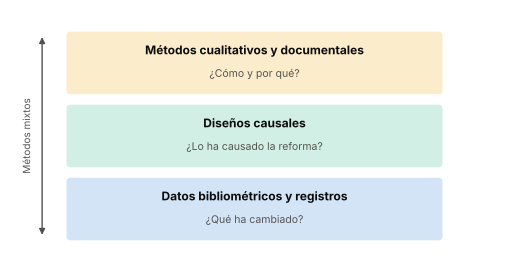

# Capítulo 12. Diseños de investigación sobre la investigación {#sec-cap12}

::: {.callout-note appearance="default"}
## Objetivos
- Elegir el diseño adecuado para preguntas causales sobre el sistema científico: experimentos, experimentos naturales y cuasiexperimentos.
- Conocer los diseños propios de la metaciencia: replicaciones a gran escala, estudios con muchos analistas y análisis multiverso.
- Valorar el papel de las encuestas, los métodos cualitativos y los métodos mixtos.
:::

::: {.callout-note appearance="simple" icon="false"}
## Glosario del capítulo
[Inferencia causal](92-glosario.qmd#gl-causal) · [Experimento de campo](92-glosario.qmd#gl-campo) · [Diferencias en diferencias](92-glosario.qmd#gl-did) · [Regresión discontinua](92-glosario.qmd#gl-rd) · [Muchos analistas](92-glosario.qmd#gl-analistas) · [Análisis multiverso](92-glosario.qmd#gl-multiverso) · [Métodos mixtos](92-glosario.qmd#gl-mixtos)
:::

::: {.callout-tip appearance="simple" icon="false"}
## Descargas
[Plantilla de entrega del reto (.qmd)](plantillas/entrega_reto.qmd){.btn .btn-outline-primary .btn-sm download="entrega_reto.qmd"}
:::

## Lectura obligatoria

::: {.lectura}
Silberzahn, R.; Uhlmann, E. L.; Martin, D. P.; Anselmi, P.; Aust, F. et al. (2018). [Many analysts, one data set: Making transparent how variations in analytic choices affect results](https://doi.org/10.1177/2515245917747646). *Advances in Methods and Practices in Psychological Science*, 1(3), 337-356.
:::

### Lectura complementaria {.unnumbered}

- @steegen2016

## 1. Preguntas causales sobre la ciencia

Muchas preguntas de la metaciencia son causales: ¿la revisión doble ciega reduce los sesgos?, ¿las ayudas aumentan la productividad?, ¿los mandatos de datos abiertos aumentan la reutilización? Los datos bibliométricos son observacionales y están llenos de factores de confusión (los mejores grupos obtienen más fondos **y** publican más), así que hacen falta diseños que aproximen la comparación contrafactual.

| Diseño | Idea | Ejemplo en metaciencia |
|---|---|---|
| **Experimento aleatorizado** | El investigador asigna al azar la intervención | Asignar al azar manuscritos a revisión simple o doble ciega |
| **Experimento de campo** | Aleatorización en un entorno real | Enviar correos idénticos con nombres distintos a investigadores para medir sesgos en la respuesta |
| **Experimento natural** | Un cambio externo asigna «casi al azar» | Una lotería entre candidatos de igual puntuación en una convocatoria |
| **Diferencias en diferencias** | Comparar el cambio antes y después en un grupo afectado frente a uno no afectado | Efecto de un mandato de acceso abierto de un financiador frente a otro que no lo aplica |
| **Regresión discontinua** | Comparar justo por encima y por debajo de un umbral | Proyectos que quedan justo por encima o por debajo de la nota de corte de financiación |
| **Control sintético** | Construir un «gemelo» ponderado de la unidad tratada | Un país que cambia su sistema de evaluación |

Las condiciones de validez se deben argumentar: en diferencias en diferencias, las **tendencias paralelas** antes de la intervención; en la regresión discontinua, que no se pueda **manipular** la posición respecto al umbral.

## 2. Diseños propios de la metaciencia

- **Replicaciones a gran escala**: muchos equipos repiten estudios publicados con protocolos preregistrados (proyectos de la Open Science Collaboration, Many Labs, el proyecto de reproducibilidad en biología del cáncer). Miden la replicabilidad de un campo, no la de un estudio aislado.
- **Muchos analistas**: @silberzahn2018 dieron los mismos datos (¿reciben más tarjetas rojas los futbolistas de piel más oscura?) a 29 equipos. Los efectos estimados variaron mucho (de nulos a claramente positivos) por decisiones analíticas razonables, sin que la experiencia de los equipos explicara las diferencias. La conclusión: **la incertidumbre analítica** es una fuente de variación tan real como la muestral.
- **Análisis multiverso** [@steegen2016]: en lugar de un único análisis, se ejecutan todas las combinaciones razonables de decisiones (exclusiones, codificaciones, covariables) y se informa de la distribución de resultados. Su versión gráfica es la **curva de especificaciones**.
- **Estudios de auditoría de la literatura**: codificar sistemáticamente una muestra de artículos (por ejemplo, disponibilidad de datos, preregistro, potencia) para estimar la prevalencia de prácticas.

## 3. Encuestas, métodos cualitativos y mixtos

No todo se mide con bases de datos. Las **encuestas** a investigadores estiman actitudes y prácticas (por ejemplo, prevalencia autodeclarada de prácticas cuestionables), con sus problemas de deseabilidad social y de respuesta. Los **métodos cualitativos** (entrevistas, grupos de discusión, etnografía de laboratorio, análisis documental de políticas y convocatorias) explican **cómo** y **por qué** funcionan las normas y los incentivos. Los **métodos mixtos** combinan ambos: por ejemplo, un análisis bibliométrico de un cambio de política seguido de análisis documental de las convocatorias para interpretar el mecanismo.

{#fig-c12-capas fig-alt="Tres bloques apilados. Abajo, datos bibliométricos y registros: qué ha cambiado. En medio, diseños causales: si la reforma lo ha causado. Arriba, métodos cualitativos y documentales: cómo y por qué. Flechas laterales indican que las tres capas se combinan en métodos mixtos."}

## Laboratorio: un análisis multiverso {#lab-c12-multiverso}

::: {.laboratorio}
::: {.laboratorio-etiqueta}
Laboratorio · se ejecuta en tu navegador
:::

Una investigación estudia si los artículos con datos abiertos reciben más citas. Hay cuatro decisiones razonables con dos opciones cada una: 16 análisis posibles. Elige tu especificación favorita y compárala con el multiverso entero.

```{ojs}
//| echo: false
seleccion = window.Lab.seleccion
viewof m1 = seleccion("Ventana de citación", ["3 años", "5 años"], {value: "3 años"})
viewof m2 = seleccion("Excluir revisiones", ["Sí", "No"], {value: "Sí"})
viewof m3 = seleccion("Controlar por revista", ["Sí", "No"], {value: "No"})
viewof m4 = seleccion("Transformación de las citas", ["log(citas + 1)", "Citas brutas"], {value: "log(citas + 1)"})
```

```{ojs}
//| echo: false
{
  const base = 0.12, efectos = [0.03, -0.04, -0.07, 0.05];
  const todas = [];
  for (let a = 0; a < 2; a++) for (let b = 0; b < 2; b++) for (let c = 0; c < 2; c++) for (let e = 0; e < 2; e++) {
    const est = base + a * efectos[0] + b * efectos[1] + c * efectos[2] + e * efectos[3] + 0.015 * Math.sin(1 + a * 3 + b * 5 + c * 7 + e * 11);
    const ee = e ? 0.055 : 0.035;
    todas.push({k: `${a}${b}${c}${e}`, est, ee, sig: Math.abs(est / ee) > 1.96});
  }
  const mia = `${m1 === "5 años" ? 1 : 0}${m2 === "No" ? 1 : 0}${m3 === "Sí" ? 1 : 0}${m4 === "Citas brutas" ? 1 : 0}`;
  const orden = [...todas].sort((x, y) => x.est - y.est);
  const X = i => 30 + i * 32, Y = v => 150 - v * 600;
  const barras = orden.map((t, i) => `<line x1="${X(i)}" y1="${Y(t.est - 1.96 * t.ee)}" x2="${X(i)}" y2="${Y(t.est + 1.96 * t.ee)}" stroke="${t.k === mia ? "#eb6834" : "#a3a29e"}" stroke-width="${t.k === mia ? 3 : 1.5}"/><circle cx="${X(i)}" cy="${Y(t.est)}" r="${t.k === mia ? 6 : 4}" fill="${t.sig ? "#2a78d6" : "var(--bs-body-bg)"}" stroke="${t.k === mia ? "#eb6834" : "#2a78d6"}" stroke-width="1.6"/>`).join("");
  const yo = todas.find(t => t.k === mia), nsig = todas.filter(t => t.sig).length;
  const d = html`<div role="status"></div>`;
  d.innerHTML = `<svg viewBox="0 0 560 220" width="100%" style="max-width:560px" role="img" aria-label="Curva de especificaciones con 16 análisis ordenados por efecto">
    <line x1="20" y1="${Y(0)}" x2="550" y2="${Y(0)}" stroke="currentColor" opacity=".5" stroke-dasharray="4 3"/>${barras}
    <text x="20" y="${Y(0) - 5}" font-size="11" fill="currentColor">efecto nulo</text></svg>
    <p>Tu análisis: efecto <strong>${yo.est.toFixed(3).replace(".", ",")}</strong>, ${yo.sig ? "<strong>significativo</strong>" : "<strong>no significativo</strong>"} (en naranja). En el multiverso, <strong>${nsig} de 16</strong> especificaciones son significativas (puntos rellenos).</p>
    <p class="small">Si solo publicaras tu especificación, el lector no sabría que la conclusión depende de decisiones razonables. Datos simulados con fines didácticos.</p>`;
  return d;
}
```
:::

## Ejercicios

### Ejercicio 12.1 · Diferencias en diferencias {.unnumbered}

Un financiador impone el acceso abierto en 2020. El porcentaje de artículos en abierto de sus proyectos pasa del 40 % al 75 %; en un financiador comparable sin mandato, del 38 % al 55 %. Calcula el efecto estimado (en puntos porcentuales).

```{webr}
#| exercise: c12_did
tratado_antes <- 40; tratado_despues <- 75
control_antes <- 38; control_despues <- 55
(tratado_despues - tratado_antes) - (control_despues - ______)
```

::: {.hint exercise="c12_did"}
Al cambio del grupo tratado se le resta el cambio del grupo de control: `control_despues - control_antes`.
:::

::: {.solution exercise="c12_did"}
```r
tratado_antes <- 40; tratado_despues <- 75
control_antes <- 38; control_despues <- 55
(tratado_despues - tratado_antes) - (control_despues - control_antes)
```
18 puntos: de los 35 puntos de aumento, 17 habrían ocurrido igualmente (tendencia general hacia el acceso abierto). La estimación es válida si ambos grupos seguían tendencias paralelas antes de 2020.
:::

```{webr}
#| exercise: c12_did
#| check: true
if (isTRUE(all.equal(as.numeric(.result), 18))) list(correct = TRUE, message = "Correcto: 18 puntos porcentuales.") else list(correct = FALSE, message = "Resta control_antes al valor final del control.")
```

### Ejercicio 12.2 · Contar el multiverso {.unnumbered}

Un análisis tiene 3 formas razonables de tratar los valores atípicos, 2 conjuntos de covariables, 4 definiciones de la variable dependiente y 2 criterios de exclusión. ¿Cuántos análisis forman el multiverso?

```{webr}
#| exercise: c12_multi
opciones <- c(3, 2, 4, 2)
______(opciones)
```

::: {.hint exercise="c12_multi"}
Las combinaciones se multiplican: `prod()`.
:::

::: {.solution exercise="c12_multi"}
```r
opciones <- c(3, 2, 4, 2)
prod(opciones)
```
48 análisis con solo cuatro decisiones: el «jardín de los senderos que se bifurcan» del capítulo 4 se vuelve visible.
:::

```{webr}
#| exercise: c12_multi
#| check: true
if (isTRUE(all.equal(as.numeric(.result), 48))) list(correct = TRUE, message = "Correcto: 48 análisis.") else list(correct = FALSE, message = "Multiplica con prod().")
```

## Actividades

::: {.clasificar #ia-c12-diseno titulo="¿Qué diseño es?" categorias="Experimento aleatorizado|Diferencias en diferencias|Regresión discontinua|Muchos analistas o multiverso"}
- Asignar al azar a los revisores la versión con o sin nombre de los autores → Experimento aleatorizado
- Comparar la producción de proyectos justo por encima y por debajo de la nota de corte → Regresión discontinua
- Comparar el cambio en reutilización de datos antes y después de un mandato con un grupo sin mandato → Diferencias en diferencias
- Pedir a 20 equipos que analicen los mismos datos para responder la misma pregunta → Muchos analistas o multiverso
:::

::: {.clasificar #ia-c12-metodo titulo="¿Método cuantitativo, cualitativo o mixto?" categorias="Cuantitativo|Cualitativo|Mixto"}
- Análisis documental de 30 convocatorias para entender cómo se define la «excelencia» → Cualitativo
- Estimar la prevalencia de preregistros en 1000 artículos codificados → Cuantitativo
- Medir el efecto de una política con datos bibliométricos y explicar su mecanismo con análisis documental → Mixto
:::

## Reto evaluable {#reto-c12}

::: {.callout-important appearance="simple" icon="false"}
## Reto del capítulo 12 · Diseña tu estudio de metaciencia
1. Formula una pregunta causal sobre el sistema científico de tu entorno.
2. Elige un diseño (experimento natural, diferencias en diferencias, regresión discontinua…) que puedas llevar a cabo tú solo con datos existentes, y argumenta sus supuestos.
3. Identifica las decisiones analíticas principales y propón un análisis multiverso.
4. Redacta un preregistro breve en el formato de OSF, con las limitaciones dentro de la sección de metodología.

**Entrega:** con la [plantilla de entrega](plantillas/entrega_reto.qmd). Este reto **no tiene solución en el libro**.
:::

## Autoevaluación

Responde a todas las preguntas y pulsa **Mostrar respuestas**. No cuenta para la nota.

::: {.webex-check .webex-box}
1. En @silberzahn2018, los 29 equipos obtuvieron prácticamente el mismo efecto. 
2. El supuesto clave de diferencias en diferencias son las tendencias 
3. Comparar casos justo por encima y por debajo de un umbral es una regresión 
4. Un análisis multiverso informa de los resultados de todas las combinaciones razonables de decisiones. 
5. La representación gráfica de un multiverso es la curva de 
6. Las encuestas sobre prácticas cuestionables pueden estar afectadas por la deseabilidad social. 
7. Combinar datos bibliométricos con análisis documental es un diseño de métodos 
8. ¿Qué muestran los estudios con muchos analistas?


:::

::: {.webex-solution boton="Ver explicaciones"}
- Variaron mucho.
- Sin intervención, ambos grupos habrían cambiado igual.
- *Regression discontinuity*.
- @steegen2016.
- *Specification curve*.
- Respuestas socialmente aceptables.
- *Mixed methods*.
- Incertidumbre analítica.
:::
